# ARCHITECTURE.md
### System diagram and the four load-bearing data flows, traced from actual code

## 1. System diagram

```mermaid
flowchart LR
  subgraph Clients["10 apps"]
    POS[pos-web · tenant POS]
    ADM[admin-web · Super Admin]
    OWN[owner-web]
    TECH[tech-web]
    CUST[customer-web]
    MPW[manager-pay-web · Tap to Pay]
    DISP[customer-display]
    KIOSK[go-check-in-kiosk · HTML]
    MKT[marketing site · WordPress]
  end
  API[NestJS API · apps/api\n265 controllers · 2,281 routes]
  DB[(PostgreSQL 16\n577 tables · 431 migrations)]
  subgraph Workers["7 env-gated background workers"]
    W1[security audit engine]
    W2[customer reconciliation · 7PM]
    W3[customer import]
    W4[customer data jobs]
    W5[SMS reconciliation · 03:30]
    W6[billing cycle]
    W7[billing export]
  end
  subgraph Providers["external · OWNER-gated credentials"]
    TW[Twilio SMS/Verify]:::ext
    SG[SendGrid email]:::ext
    FI[Fiserv/CommerceHub payments]:::ext
    AP[APNs push]:::ext
    FCM[FCM push]:::ext
  end
  Clients -->|HTTPS + session cookie| API
  API --> DB
  Workers --> DB
  API -.->|configured only| Providers
  classDef ext stroke-dasharray: 5 5;
```

Every client speaks HTTPS to the one API with the HMAC session cookie (AUTH_AND_SECURITY.md). Workers are the
same codebase, enabled per environment by `*_WORKER_ENABLED` flags (DEPLOYMENT.md lists them). Dashed provider
edges are honest: unconfigured providers REPORT unconfigured (`NotConfiguredPushProvider`, "Provider Cost Not
Available") — nothing fakes connectivity.

## 2. Realtime, in one paragraph
`src/realtime/realtime-core.ts` defines the event vocabulary (`EVENTS`), typed envelopes (`makeEnvelope`),
minimal-payload rules (`payloadViolations` rejects fat payloads), and `screensToRefetch(event)` — the map from
an event to exactly which screens re-fetch. The bus (`realtime-bus.ts`) delivers tenant/branch-scoped SSE.
The rules: targeted updates carrying ids + the changed slice; no global broadcast; no full-screen POS refresh.

**All 44 event names (from `EVENTS` in realtime-core.ts, verbatim):** appointment_created ·
appointment_updated · appointment_cancelled · customer_checked_in · queue_updated · ticket_assigned ·
service_started · service_done · ticket_ready_checkout · service_paused · service_resumed ·
checkout_total_recalculated · customer_display_tip_selected · customer_display_payment_requested ·
customer_display_method_selected · customer_display_signature_captured · payment_processing_started ·
payment_approved · payment_failed · ticket_paid · receipt_sent · reports_updated ·
technician_earnings_updated · settings_updated · tenant_status_updated · time_clock_updated ·
customer_profile_updated · owner_alert_created · owner_alert_updated · owner_payroll_updated ·
ticket_service_line_added · ticket_service_line_updated · ticket_service_line_removed ·
ticket_total_recalculated · ticket_change_request_created · ticket_change_request_approved ·
ticket_change_request_rejected · technician_profile_updated · tech_salon_membership_requested ·
tech_salon_membership_approved · tech_salon_membership_rejected · technician_rating_submitted ·
daily_follow_up_tasks_created · follow_up_task_updated · customer_follow_up_received ·
technician_help_requested · technician_help_accepted · technician_help_declined ·
ticket_line_technician_assigned. (Regenerate this list from the constant when it changes — it is the wire
vocabulary, and `payloadViolations` rejects envelopes carrying forbidden keys like pan/cvv/password.)

**Queue/ticket status vocabulary (actual strings from code, §16):** the check-in lifecycle runs
`waiting → called → assigned → accepted → in_service → service_done → moved_to_tech_queue` with terminal
`completed` / `cancelled`; checkout then drives the ticket to paid via the payment events above. Every move is
idempotency-keyed (DB_TRANSACTIONS_AND_CONCURRENCY.md).

**The 1:00 AM security audit (§18) is real and verified in code** (`super-admin-security/audit-engine.service.ts`):
armed by `SECURITY_AUDIT_WORKER_ENABLED`, it fires in the 01:00–01:59 local window when the last completed run
is >20h old, takes a Postgres advisory lock so multiple instances can't double-run, deduplicates findings by
fingerprint, and surfaces new critical/high findings to the Super Admin Security screen. Manual run available
from that screen. It has never run in production because none exists — the mechanism is what's verified.

## 3. The four flows (§39), file-pointer accurate
**Booking** — customer-web / AI / partner links → signed booking context (`ai-booking-signed-context.ts`,
public channels can't forge tenant scope) → phone verification via the SMS entitlement gate
(`sms-packages/sms-entitlement.service.ts` decides send-vs-block-vs-overage BEFORE Twilio; ledger row per
submission, SID-deduped) → `customer-booking/*` writes **`pos_tech_appointments`** → realtime event →
booking screens refetch.

**Check-in** — kiosk (Go Check-In) or front desk → customer lookup/registration → `pos_queue_items` row →
assignment (tap / drag / auto-balance / AI) via `queue.assignTechnician` → technician push ("New assignment")
+ customer SMS/push on `callNext` — pushes are best-effort and never block the assignment.

**Checkout** — serving → ticket engine (`tickets` + lines, integer cents; tips via the shared money core in
`packages/ui`, surcharge rules) → payment (Fiserv sandbox path today — PAYMENTS_INTEGRATION.md) →
commission/earnings ledger write (rules from the compensation system: splits, helper allocation, product cost)
→ receipt + customer-display update → realtime.

**Customer identity sync** — nightly 7 PM worker (`customer-identity/customer-reconciliation.service.ts`)
reconciles per-tenant `customers` rows against global identities: exact/normalized matching, duplicates merged
WITHIN a tenant per rules, cross-tenant conflicts FILED as findings for human review — never auto-merged, never
copied across tenants.

## 4. Repository map (§5 — the actual tree, top levels)
```
/
├── apps/            api · pos-web · admin-web · owner-web · tech-web · customer-web ·
│                    manager-pay-web · customer-display · go-check-in-kiosk · booking-public
├── packages/ui      shared UI + the money core (parseDollarsToCents, TipKeypad)
├── marketing/       WordPress marketing-site package (deployed separately to GoDaddy)
├── apple-readiness/ iOS store-readiness notes/assets (19 files)
│                    (HANDOFF/ and _MERGE_ARTIFACTS/ — historical snippets and fix-package deltas — were removed
│                    Oct 10 2026, Constitution 13 §388; they are in git history at 62a1875d)
├── *.md             ~400 root docs: ~25 canonical (HANDOFF_MANIFEST.md) + preserved dated history
└── Dockerfile · docker-compose.yml · .github/workflows/security.yml
```
Entry points: API `apps/api/src/main.ts` · each web app `src/main.tsx` · kiosk HTML apps are single files.

## 5. Design rules that explain "why is it built this way"
Reuse-first (audit before build) · one engine per concern, thin delegates · honesty over polish (unconfigured ≠
mocked) · human approval for money-adjacent reconciliation (findings, never auto-fixes) · every claim gated or
tested (14 gates + 6,091-test battery — TEST_REPORT.md).
