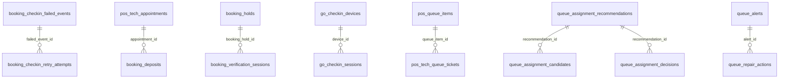
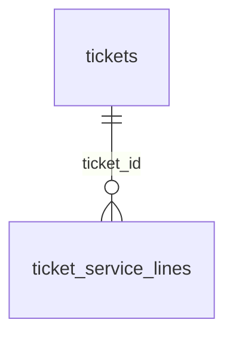
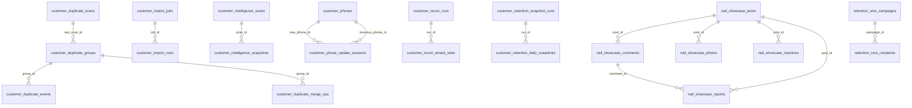
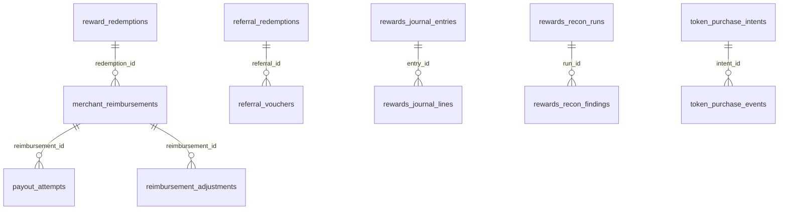
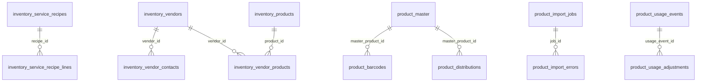
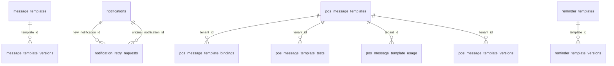

# DB_ERD_AND_DOMAINS.md

**GENERATED FROM THE REAL SCHEMA — do not hand-edit.** All 759 migrations replayed into PGlite (PG16) through
`apps/api/db/migration-sql.mjs`, then introspected. Regenerate: `cd apps/api && node scripts/generate-db-docs.mjs > ../../DB_ERD_AND_DOMAINS.md`

**955 tables · 559 foreign keys (0 NOT VALID) · 3133 indexes · 754 tables carry `tenant_id`.**

Ownership class (Constitution 1 §3) and domain (§7) per table are the machine-readable registry
`apps/api/db/ownership/registry.generated.json` (gate `check:db-ownership`): heuristics in `db/ownership/heuristics.mjs`,
hand decisions with reasons in `db/ownership/overrides.json`. Sensitivity uses Constitution 12's classes; retention and delete
policy come from `apps/api/db/retention-policy.json` (absent = indefinite / none).

## Ownership classes

| Class | Meaning | Tables |
| --- | --- | ---: |
| A `platform_global` | platform-global — no tenant_id | 160 |
| B `tenant_owned` | tenant-owned — tenant_id required | 636 |
| C `tenant_branch_owned` | tenant + branch owned — tenant_id and NOT NULL branch_id | 90 |
| D `platform_identity_tenant_relationship` | platform identity / tenant relationship | 44 |
| E `cross_tenant_platform_data` | intentionally cross-tenant — explicit visibility rules | 25 |

101 tables have a nullable tenant_id (rows with NULL are platform-level rows by design, flagged `platform_rows` in the registry;
Constitution 1 §3 E: a nullable tenant_id never by itself makes data cross-tenant). 54 tables are append-only (a trigger or rule refuses UPDATE).

## Domain overview

| Domain | Tables | A | B | C | D | E | With tenant_id | FKs out |
| --- | ---: | ---: | ---: | ---: | ---: | ---: | ---: | ---: |
| PLATFORM | 20 | 17 | 3 | 0 | 0 | 0 | 3 | 12 |
| IDENTITY | 41 | 5 | 10 | 1 | 25 | 0 | 24 | 40 |
| TENANTS | 29 | 1 | 27 | 1 | 0 | 0 | 28 | 21 |
| CUSTOMERS | 57 | 1 | 46 | 4 | 2 | 4 | 52 | 35 |
| BOOKING | 43 | 1 | 25 | 17 | 0 | 0 | 42 | 19 |
| WORKFORCE | 76 | 2 | 49 | 9 | 14 | 2 | 65 | 48 |
| OPERATIONS | 77 | 23 | 46 | 6 | 0 | 2 | 54 | 33 |
| CATALOG | 21 | 7 | 10 | 4 | 0 | 0 | 14 | 9 |
| INVENTORY | 29 | 5 | 14 | 10 | 0 | 0 | 24 | 8 |
| CHECKOUT | 14 | 0 | 8 | 6 | 0 | 0 | 14 | 6 |
| PAYMENTS | 59 | 1 | 47 | 8 | 0 | 3 | 55 | 42 |
| FINANCE | 83 | 15 | 67 | 1 | 0 | 0 | 68 | 96 |
| MARKETING | 24 | 10 | 12 | 2 | 0 | 0 | 14 | 17 |
| DEALS | 18 | 0 | 18 | 0 | 0 | 0 | 18 | 17 |
| LOYALTY | 36 | 5 | 26 | 1 | 1 | 3 | 30 | 12 |
| MEMBERSHIPS | 11 | 3 | 7 | 1 | 0 | 0 | 8 | 0 |
| COMMUNICATIONS | 41 | 5 | 36 | 0 | 0 | 0 | 36 | 16 |
| AI | 141 | 11 | 122 | 8 | 0 | 0 | 130 | 70 |
| ANALYTICS | 18 | 8 | 1 | 9 | 0 | 0 | 10 | 0 |
| SUPPORT | 57 | 20 | 26 | 0 | 0 | 11 | 26 | 38 |
| AUDIT | 29 | 7 | 20 | 2 | 0 | 0 | 22 | 9 |
| SECURITY | 31 | 13 | 16 | 0 | 2 | 0 | 17 | 11 |

## Source of truth (§105)

One authoritative table per business fact. Duplicates found by the Phase 10 audit and how each is resolved:

| Fact | Authoritative | Not authoritative |
| --- | --- | --- |
| Tenant (salon) | tenants | — |
| Staff sign-in identity | users (one row per tenant membership) | — |
| Customer sign-in identity | customer_identities | global_customers (cross-salon customer root — which root wins is Kevin's decision) |
| Salon customer relationship | customers | — |
| Appointment | pos_tech_appointments | — |
| Current queue state | pos_queue_items | — |
| Ticket / sale | tickets + ticket_service_lines | — |
| Payment | payments (+ payment_refunds) | payment_intents / payment_attempts (attempt history) |
| Loyalty balance | loyalty_ledger (sum of delta) | customer_loyalty_profiles.points_balance (materialised, reconciled daily); loyalty_point_earnings (per-payment earn events) |
| Gift card balance | gift_card_transactions | gift_cards.balance_cents (materialised) |
| Inventory on hand | inventory_stock_movements + inventory_location_stock (projection) | — |
| Deal redemption | deal_redemptions | customer_deals / tenant_promotion_redemptions (frozen legacy stores) |
| Audit trail | audit_events (platform) and audit_logs (tenant-facing log) — both append-only | — |
| Support access session | support_access_sessions | super_admin_support_sessions, membership_support_sessions (merged away in Phase 10) |
| Idempotency key | api_idempotency (scope column) | ai_checkout_upsell_idempotency, voice_gateway_idempotency (merged away in Phase 10) |
| Domain events | outbox_events (+ processed_events for consumers) | — |

## BOOKING — ERD (FK edges within the domain)

Parents in other domains: branches, customer_display_devices, customers, payments, schedule_optimization_runs, technicians, tenants, tickets.

## CHECKOUT — ERD (FK edges within the domain)

Parents in other domains: customers, pos_stations, technicians, tenants.

## PAYMENTS — ERD (FK edges within the domain)

```mermaid
erDiagram
  chargebacks ||--o{ dispute_evidence : "chargeback_id"
  chargebacks ||--o{ dispute_funds_events : "chargeback_id"
  chargebacks ||--o{ dispute_outcomes : "chargeback_id"
  chargebacks ||--o{ dispute_status_events : "chargeback_id"
  chargebacks ||--o{ dispute_submissions : "chargeback_id"
  chargebacks ||--o{ dispute_tenant_notifications : "chargeback_id"
  gift_cards ||--o{ gift_card_adjustments : "gift_card_id"
  gift_cards ||--o{ gift_card_claim_tokens : "gift_card_id"
  gift_card_programs ||--o{ gift_card_clearing_entries : "program_id"
  gift_card_settlement_batches ||--o{ gift_card_clearing_entries : "settlement_batch_id"
  gift_cards ||--o{ gift_card_clearing_entries : "gift_card_id"
  gift_cards ||--o{ gift_card_deliveries : "gift_card_id"
  gift_cards ||--o{ gift_card_fraud_flags : "gift_card_id"
  gift_cards ||--o{ gift_card_presentation_tokens : "gift_card_id"
  gift_card_programs ||--o{ gift_card_program_members : "program_id"
  gift_cards ||--o{ gift_card_recipients : "gift_card_id"
  gift_cards ||--o{ gift_card_redemption_holds : "gift_card_id"
  gift_card_programs ||--o{ gift_card_settlement_batches : "program_id"
  gift_cards ||--o{ gift_card_stock : "gift_card_id"
  gift_cards ||--o{ gift_card_transactions : "gift_card_id"
  merchant_pricing_plans ||--o{ merchant_rate_schedules : "pricing_plan_id"
  mobile_pay_devices ||--o{ mobile_pay_device_branches : "tenant_id"
  payments ||--o{ payment_refunds : "payment_id"
  payments ||--o{ payment_signatures : "payment_id"
  payment_settlements ||--o{ payments : "settlement_batch_id"
  bank_deposits ||--o{ reconciliation_allocations : "deposit_id"
  payment_settlements ||--o{ reconciliation_allocations : "settlement_id"
```

Parents in other domains: branches, residual_statements, tenants, tickets.

## CUSTOMERS — ERD (FK edges within the domain)

Parents in other domains: tenants, users.

## LOYALTY — ERD (FK edges within the domain)

Parents in other domains: customer_identities, tenants.

## WORKFORCE — ERD (FK edges within the domain)

```mermaid
erDiagram
  tech_portfolio_photos ||--o{ nail_photo_consent : "photo_id"
  schedule_optimization_recommendations ||--o{ schedule_change_applications : "recommendation_id"
  schedule_optimization_recommendations ||--o{ schedule_change_proposals : "recommendation_id"
  schedule_optimization_runs ||--o{ schedule_conflicts : "run_id"
  schedule_optimization_runs ||--o{ schedule_gaps : "run_id"
  schedule_optimization_runs ||--o{ schedule_optimization_recommendations : "run_id"
  schedule_optimization_recommendations ||--o{ schedule_recommendation_decisions : "recommendation_id"
  schedule_optimization_recommendations ||--o{ schedule_recommendation_impacts : "recommendation_id"
  schedule_optimization_runs ||--o{ staffing_coverage_recommendations : "run_id"
  team_data_alerts ||--o{ team_data_alert_events : "tenant_id"
  team_training_courses ||--o{ team_training_assignments : "tenant_id"
  tech_dm_threads ||--o{ tech_dm_messages : "thread_id"
  tech_portfolio_photos ||--o{ tech_portfolio_photo_tenant_hides : "photo_id"
  global_tech_profiles ||--o{ tech_profile_change_requests : "global_tech_profile_id"
  technician_certifications ||--o{ technician_certification_reminders : "certification_id"
  technicians ||--o{ technician_employment_events : "technician_id"
```

Parents in other domains: branches, tenant_skills, tenants, users.

## INVENTORY — ERD (FK edges within the domain)

## COMMUNICATIONS — ERD (FK edges within the domain)

Parents in other domains: tenant_sms_billing_cycles, tenants.

## Full table inventory

Class: §3 letter. T/B: tenant_id / branch_id present. AO: append-only.

| Table | Domain | Class | Sensitivity | Retention / delete | Cols | Idx | T | B | AO |
| --- | --- | :-: | --- | --- | ---: | ---: | :-: | :-: | :-: |
| access_requests | IDENTITY | B* | HIGHLY_SENSITIVE | indefinite / none | 17 | 4 | ✓ | — |  |
| access_review_items | SECURITY | B | HIGHLY_SENSITIVE | indefinite / none | 14 | 3 | ✓ | — |  |
| access_reviews | SECURITY | B | CONFIDENTIAL | indefinite / none | 8 | 3 | ✓ | — |  |
| account_deletion_requests | IDENTITY | D* | HIGHLY_SENSITIVE | indefinite / none | 14 | 3 | ✓ | — |  |
| admin_commission_auth_codes | FINANCE | B | SECURITY_SECRET | indefinite / none | 8 | 2 | ✓ | — |  |
| advertising_global_policy | MARKETING | A | INTERNAL | indefinite / none | 7 | 1 | — | — |  |
| advertising_policy_events | MARKETING | A | INTERNAL | indefinite / none | 8 | 1 | — | — | ✓ |
| ai_billing_events | AI | B* | INTERNAL | financial / never | 12 | 3 | ✓ | — |  |
| ai_billing_invoice_events | AI | B* | HIGHLY_SENSITIVE | indefinite / none | 10 | 3 | ✓ | — | ✓ |
| ai_billing_invoice_line_snapshots | AI | B | HIGHLY_SENSITIVE | indefinite / none | 12 | 3 | ✓ | — |  |
| ai_billing_invoice_links | AI | B | PAYMENT_RESTRICTED | indefinite / none | 32 | 4 | ✓ | — |  |
| ai_billing_reconciliation_runs | AI | B | INTERNAL | indefinite / none | 17 | 3 | ✓ | — |  |
| ai_booking_conversion_events | AI | B | INTERNAL | indefinite / none | 13 | 5 | ✓ | ✓ |  |
| ai_booking_health_runs | AI | B | INTERNAL | indefinite / none | 7 | 2 | ✓ | ✓ |  |
| ai_booking_recovery_dismissals | AI | B | INTERNAL | indefinite / none | 6 | 2 | ✓ | — |  |
| ai_booking_revoked_links | AI | B | INTERNAL | indefinite / none | 5 | 1 | ✓ | — |  |
| ai_budget_alerts | AI | B | INTERNAL | indefinite / none | 9 | 3 | ✓ | — |  |
| ai_budgets | AI | B | INTERNAL | indefinite / none | 9 | 2 | ✓ | — |  |
| ai_business_alert_events | AI | B | HIGHLY_SENSITIVE | indefinite / none | 23 | 3 | ✓ | ✓ |  |
| ai_business_alerts | AI | B | INTERNAL | indefinite / none | 17 | 3 | ✓ | ✓ |  |
| ai_business_health_runs | AI | B | INTERNAL | indefinite / none | 8 | 2 | ✓ | ✓ |  |
| ai_business_report_jobs | AI | B | INTERNAL | indefinite / none | 13 | 3 | ✓ | ✓ |  |
| ai_business_saved_questions | AI | B | INTERNAL | indefinite / none | 11 | 3 | ✓ | — |  |
| ai_business_setup_preview_runs | AI | B | CONFIDENTIAL | indefinite / none | 10 | 2 | ✓ | ✓ |  |
| ai_calendar_health_runs | AI | B | INTERNAL | indefinite / none | 8 | 2 | ✓ | ✓ |  |
| ai_calls_health_runs | AI | B | INTERNAL | indefinite / none | 7 | 2 | ✓ | ✓ |  |
| ai_checkout_upsell_dismissals | AI | C | INTERNAL | indefinite / none | 8 | 2 | ✓ | ✓ |  |
| ai_checkout_upsell_feedback | AI | C | INTERNAL | indefinite / none | 9 | 2 | ✓ | ✓ |  |
| ai_checkout_upsell_recommendations | AI | C | INTERNAL | indefinite / none | 16 | 5 | ✓ | ✓ |  |
| ai_checkout_upsell_settings | AI | B | INTERNAL | indefinite / none | 13 | 3 | ✓ | ✓ |  |
| ai_checkout_upsell_settings_history | AI | B | INTERNAL | indefinite / none | 15 | 2 | ✓ | ✓ |  |
| ai_control_modes | AI | B | INTERNAL | indefinite / none | 8 | 3 | ✓ | — |  |
| ai_customer_profile_settings | AI | B | CONFIDENTIAL | indefinite / none | 12 | 3 | ✓ | ✓ |  |
| ai_customer_profile_settings_events | AI | B | CONFIDENTIAL | indefinite / none | 14 | 2 | ✓ | ✓ | ✓ |
| ai_feedback | AI | B | HIGHLY_SENSITIVE | indefinite / none | 15 | 4 | ✓ | ✓ |  |
| ai_follow_up_activity | AI | B | HIGHLY_SENSITIVE | indefinite / none | 10 | 2 | ✓ | — | ✓ |
| ai_follow_up_contact_attempts | AI | B | HIGHLY_SENSITIVE | indefinite / none | 13 | 3 | ✓ | — |  |
| ai_follow_up_escalations | AI | B | INTERNAL | indefinite / none | 9 | 2 | ✓ | — |  |
| ai_follow_up_health_runs | AI | B | INTERNAL | indefinite / none | 7 | 2 | ✓ | ✓ |  |
| ai_global_prompts | AI | A | INTERNAL | indefinite / none | 9 | 2 | — | — |  |
| ai_handoff_events | AI | B | INTERNAL | indefinite / none | 11 | 4 | ✓ | ✓ |  |
| ai_insight_feedback | AI | B* | INTERNAL | indefinite / none | 11 | 4 | ✓ | — |  |
| ai_insights | AI | B* | INTERNAL | indefinite / none | 38 | 8 | ✓ | ✓ |  |
| ai_job_attempts | AI | A | INTERNAL | indefinite / none | 14 | 3 | — | — |  |
| ai_jobs | AI | B | INTERNAL | indefinite / none | 24 | 4 | ✓ | ✓ |  |
| ai_knowledge_chunks | AI | B | INTERNAL | indefinite / none | 9 | 4 | ✓ | ✓ |  |
| ai_knowledge_documents | AI | B | INTERNAL | indefinite / none | 15 | 2 | ✓ | ✓ |  |
| ai_marketing_campaign_plans | AI | B | INTERNAL | indefinite / none | 12 | 2 | ✓ | ✓ |  |
| ai_marketing_campaign_sends | AI | B | INTERNAL | indefinite / none | 13 | 5 | ✓ | ✓ |  |
| ai_marketing_health_runs | AI | B | INTERNAL | indefinite / none | 7 | 2 | ✓ | ✓ |  |
| ai_narrative_model_versions | AI | A | HIGHLY_SENSITIVE | indefinite / none | 8 | 3 | — | — |  |
| ai_plan_settings | AI | A | INTERNAL | indefinite / none | 7 | 1 | — | — |  |
| ai_price_versions | AI | A | HIGHLY_SENSITIVE | indefinite / none | 10 | 4 | — | — |  |
| ai_prompt_rollbacks | AI | A | INTERNAL | indefinite / none | 7 | 2 | — | — |  |
| ai_prompt_versions | AI | A | INTERNAL | indefinite / none | 18 | 3 | — | — | ✓ |
| ai_providers | AI | A | SECURITY_SECRET | indefinite / none | 12 | 2 | — | — |  |
| ai_queue_health_runs | AI | C | INTERNAL | indefinite / none | 7 | 2 | ✓ | ✓ |  |
| ai_receptionist_actions | AI | B | INTERNAL | indefinite / none | 21 | 4 | ✓ | ✓ |  |
| ai_receptionist_agent_events | AI | B | INTERNAL | indefinite / none | 14 | 4 | ✓ | ✓ | ✓ |
| ai_receptionist_agent_versions | AI | B | INTERNAL | indefinite / none | 7 | 3 | ✓ | — |  |
| ai_receptionist_agents | AI | B | INTERNAL | indefinite / none | 30 | 7 | ✓ | ✓ |  |
| ai_receptionist_control | AI | B | INTERNAL | indefinite / none | 17 | 2 | ✓ | ✓ |  |
| ai_receptionist_control_events | AI | B | INTERNAL | indefinite / none | 10 | 3 | ✓ | ✓ | ✓ |
| ai_receptionist_faq_events | AI | B | INTERNAL | indefinite / none | 12 | 4 | ✓ | ✓ | ✓ |
| ai_receptionist_faq_revisions | AI | B | INTERNAL | indefinite / none | 12 | 3 | ✓ | — | ✓ |
| ai_receptionist_faqs | AI | B | INTERNAL | indefinite / none | 22 | 6 | ✓ | ✓ |  |
| ai_receptionist_follow_ups | AI | B | HIGHLY_SENSITIVE | indefinite / none | 34 | 10 | ✓ | ✓ |  |
| ai_receptionist_handoffs | AI | B | INTERNAL | indefinite / none | 16 | 3 | ✓ | ✓ |  |
| ai_receptionist_health_runs | AI | B | INTERNAL | indefinite / none | 9 | 3 | ✓ | ✓ |  |
| ai_receptionist_provisioning_jobs | AI | B | INTERNAL | indefinite / none | 15 | 3 | ✓ | ✓ |  |
| ai_receptionist_settings | AI | C | INTERNAL | indefinite / none | 7 | 1 | ✓ | ✓ |  |
| ai_receptionist_settings_history | AUDIT | C | INTERNAL | indefinite / none | 9 | 3 | ✓ | ✓ |  |
| ai_report_deliveries | AI | A | INTERNAL | indefinite / none | 13 | 4 | — | — |  |
| ai_report_narratives | AI | A | INTERNAL | indefinite / none | 10 | 3 | — | — |  |
| ai_report_runs | AI | B* | INTERNAL | indefinite / none | 25 | 5 | ✓ | ✓ |  |
| ai_report_schedules | AI | B* | INTERNAL | indefinite / none | 18 | 4 | ✓ | ✓ |  |
| ai_report_templates | AI | A | INTERNAL | indefinite / none | 10 | 3 | — | — |  |
| ai_reputation_config_versions | AI | B | INTERNAL | indefinite / none | 14 | 3 | ✓ | ✓ | ✓ |
| ai_revenue_attributions | AI | B | INTERNAL | indefinite / none | 12 | 3 | ✓ | ✓ |  |
| ai_support_conversations | AI | B | INTERNAL | indefinite / none | 9 | 2 | ✓ | — |  |
| ai_support_messages | AI | B | CONFIDENTIAL | indefinite / none | 10 | 3 | ✓ | — |  |
| ai_usage_alerts | AI | B | INTERNAL | indefinite / none | 11 | 3 | ✓ | — |  |
| ai_usage_health_runs | AI | B | INTERNAL | indefinite / none | 6 | 2 | ✓ | — |  |
| ai_usage_logs | AI | B | INTERNAL | ai / never | 20 | 7 | ✓ | ✓ |  |
| alert_escalations | OPERATIONS | A | INTERNAL | operational / hard_delete_after_days | 16 | 4 | — | — |  |
| alert_notes | SUPPORT | A | HIGHLY_SENSITIVE | indefinite / none | 6 | 2 | — | — |  |
| alerts | SUPPORT | B* | INTERNAL | indefinite / none | 24 | 5 | ✓ | — |  |
| api_idempotency | OPERATIONS | B* | INTERNAL | temporary / hard_delete_after_days | 12 | 3 | ✓ | — |  |
| api_operations | OPERATIONS | B* | INTERNAL | operational / hard_delete_after_days | 23 | 3 | ✓ | ✓ |  |
| appointment_availability_recommendations | BOOKING | B | CONFIDENTIAL | indefinite / none | 18 | 2 | ✓ | ✓ |  |
| appointment_change_log | AUDIT | B | CONFIDENTIAL | audit / never | 12 | 3 | ✓ | ✓ | ✓ |
| appointment_reminder_attempts | BOOKING | B | HIGHLY_SENSITIVE | indefinite / none | 14 | 6 | ✓ | — |  |
| appointment_reminder_runs | BOOKING | B | CONFIDENTIAL | indefinite / none | 13 | 2 | ✓ | — |  |
| appointment_reminders_sent | BOOKING | B | CONFIDENTIAL | indefinite / none | 18 | 6 | ✓ | ✓ |  |
| appointment_reschedules | BOOKING | C | CONFIDENTIAL | indefinite / none | 11 | 2 | ✓ | ✓ |  |
| appointment_schedule_locks | BOOKING | B | CONFIDENTIAL | indefinite / none | 7 | 2 | ✓ | ✓ |  |
| appointment_waitlist | BOOKING | C | CONFIDENTIAL | indefinite / none | 10 | 2 | ✓ | ✓ |  |
| audit_events | AUDIT | B | INTERNAL | audit / never | 24 | 10 | ✓ | ✓ | ✓ |
| audit_evidence_custody | AUDIT | A | HIGHLY_SENSITIVE | indefinite / none | 6 | 2 | — | — |  |
| audit_evidence_packs | AUDIT | A | HIGHLY_SENSITIVE | indefinite / none | 13 | 3 | — | — |  |
| audit_export_flags | AUDIT | B* | HIGHLY_SENSITIVE | indefinite / none | 12 | 4 | ✓ | — |  |
| audit_investigation_timeline | AUDIT | A | INTERNAL | indefinite / none | 6 | 2 | — | — |  |
| audit_investigations | AUDIT | B* | INTERNAL | indefinite / none | 12 | 4 | ✓ | — |  |
| audit_legal_holds | AUDIT | A | INTERNAL | audit / never | 14 | 3 | — | — |  |
| audit_logs | AUDIT | B* | CONFIDENTIAL | audit / never | 12 | 2 | ✓ | ✓ | ✓ |
| audit_retention_policies | AUDIT | A | INTERNAL | indefinite / none | 11 | 3 | — | — |  |
| audit_tamper_controls | AUDIT | A | INTERNAL | indefinite / none | 9 | 2 | — | — |  |
| auth_devices | IDENTITY | D | INTERNAL | indefinite / none | 13 | 2 | — | — |  |
| auth_events | IDENTITY | D* | CONFIDENTIAL | audit / never | 11 | 4 | ✓ | — |  |
| authorization_audit_events | AUDIT | B* | INTERNAL | audit / never | 11 | 3 | ✓ | — | ✓ |
| authorization_denials | SECURITY | B* | INTERNAL | indefinite / none | 10 | 4 | ✓ | — |  |
| automation_exceptions | MARKETING | B | HIGHLY_SENSITIVE | indefinite / none | 16 | 3 | ✓ | ✓ |  |
| automation_executions | MARKETING | B* | INTERNAL | indefinite / none | 22 | 6 | ✓ | ✓ |  |
| automation_failures | MARKETING | B* | INTERNAL | indefinite / none | 13 | 3 | ✓ | — |  |
| automation_rule_versions | MARKETING | A | HIGHLY_SENSITIVE | indefinite / none | 18 | 2 | — | — |  |
| automation_rules | MARKETING | B* | INTERNAL | indefinite / none | 17 | 6 | ✓ | ✓ |  |
| backup_point_verifications | OPERATIONS | A | INTERNAL | indefinite / none | 9 | 2 | — | — | ✓ |
| backup_recovery_points | OPERATIONS | B* | INTERNAL | indefinite / none | 27 | 4 | ✓ | ✓ |  |
| backup_reports | OPERATIONS | A | INTERNAL | indefinite / none | 11 | 2 | — | — |  |
| backup_restore_events | OPERATIONS | A | INTERNAL | indefinite / none | 9 | 2 | — | — | ✓ |
| backup_restore_plans | OPERATIONS | B* | INTERNAL | indefinite / none | 27 | 5 | ✓ | ✓ |  |
| bank_accounts | PAYMENTS | B | PAYMENT_RESTRICTED | indefinite / none | 15 | 3 | ✓ | — |  |
| bank_deposits | PAYMENTS | B | PAYMENT_RESTRICTED | indefinite / none | 23 | 7 | ✓ | ✓ |  |
| bank_webhook_endpoints | PAYMENTS | B | SECURITY_SECRET | indefinite / none | 7 | 3 | ✓ | — |  |
| before_after_sets | WORKFORCE | D* | HIGHLY_SENSITIVE | indefinite / none | 20 | 3 | ✓ | ✓ |  |
| billing_credits | FINANCE | B | INTERNAL | indefinite / none | 12 | 2 | ✓ | — |  |
| billing_discounts | FINANCE | B* | INTERNAL | indefinite / none | 12 | 2 | ✓ | — |  |
| billing_export_jobs | FINANCE | A | SECURITY_SECRET | indefinite / none | 16 | 3 | — | — |  |
| billing_invoice_lines | FINANCE | B | HIGHLY_SENSITIVE | financial / never | 9 | 3 | ✓ | — |  |
| billing_invoices | FINANCE | B | HIGHLY_SENSITIVE | financial / never | 22 | 4 | ✓ | — |  |
| billing_kpi_snapshots | FINANCE | A | INTERNAL | indefinite / none | 5 | 2 | — | — |  |
| billing_payment_attempts | FINANCE | B | INTERNAL | financial / never | 10 | 4 | ✓ | — |  |
| billing_webhook_events | FINANCE | A | INTERNAL | indefinite / none | 8 | 3 | — | — |  |
| birthday_message_claims | CUSTOMERS | B | CONFIDENTIAL | indefinite / none | 11 | 4 | ✓ | — |  |
| bonus_rules | FINANCE | B | INTERNAL | indefinite / none | 13 | 2 | ✓ | ✓ |  |
| booking_checkin_failed_events | BOOKING | B | INTERNAL | indefinite / none | 23 | 4 | ✓ | ✓ |  |
| booking_checkin_retry_attempts | BOOKING | B | CONFIDENTIAL | indefinite / none | 14 | 5 | ✓ | ✓ |  |
| booking_deposits | BOOKING | C | PAYMENT_RESTRICTED | indefinite / none | 25 | 5 | ✓ | ✓ |  |
| booking_holds | BOOKING | C | HIGHLY_SENSITIVE | temporary / hard_delete_after_days | 23 | 9 | ✓ | ✓ |  |
| booking_verification_platform_policy | BOOKING | B* | INTERNAL | indefinite / none | 13 | 3 | ✓ | — |  |
| booking_verification_sessions | BOOKING | C | CONFIDENTIAL | temporary / hard_delete_after_days | 38 | 14 | ✓ | ✓ |  |
| booking_verification_settings | BOOKING | B | INTERNAL | indefinite / none | 22 | 3 | ✓ | ✓ |  |
| booking_verification_usage_daily | BOOKING | B | INTERNAL | indefinite / none | 10 | 3 | ✓ | — |  |
| booking_verified_phones | BOOKING | B | CONFIDENTIAL | indefinite / none | 15 | 3 | ✓ | — |  |
| branch_health_snapshots | OPERATIONS | C | INTERNAL | operational / hard_delete_after_days | 23 | 4 | ✓ | ✓ |  |
| branch_transfer_requests | WORKFORCE | E | INTERNAL | indefinite / none | 13 | 3 | — | ✓ |  |
| branches | OPERATIONS | B | HIGHLY_SENSITIVE | customer_history / soft_delete | 48 | 6 | ✓ | — |  |
| bundle_items | CATALOG | B | INTERNAL | indefinite / none | 10 | 2 | ✓ | — |  |
| bundles | CATALOG | B | HIGHLY_SENSITIVE | customer_history / soft_delete | 18 | 2 | ✓ | ✓ |  |
| business_categories | CATALOG | A | PUBLIC | indefinite / none | 11 | 4 | — | — |  |
| call_consent_records | AI | B | INTERNAL | indefinite / none | 16 | 3 | ✓ | ✓ |  |
| call_deletion_events | AI | B | HIGHLY_SENSITIVE | indefinite / none | 11 | 3 | ✓ | ✓ |  |
| call_intelligence_events | AI | B | CONFIDENTIAL | indefinite / none | 17 | 5 | ✓ | ✓ |  |
| call_redaction_events | AI | B | HIGHLY_SENSITIVE | indefinite / none | 8 | 3 | ✓ | ✓ |  |
| call_transcript_intelligence | AI | B | HIGHLY_SENSITIVE | indefinite / none | 16 | 4 | ✓ | ✓ |  |
| call_transcript_segments | AI | B | HIGHLY_SENSITIVE | indefinite / none | 19 | 4 | ✓ | ✓ |  |
| call_transcripts | AI | B | HIGHLY_SENSITIVE | ai / soft_delete | 26 | 7 | ✓ | ✓ |  |
| campaign_compliance_flags | MARKETING | B* | INTERNAL | indefinite / none | 15 | 5 | ✓ | — |  |
| campaign_delivery_failures | COMMUNICATIONS | B* | INTERNAL | indefinite / none | 14 | 4 | ✓ | — |  |
| campaign_delivery_rollups | COMMUNICATIONS | B* | INTERNAL | indefinite / none | 9 | 3 | ✓ | — |  |
| campaign_health_runs | MARKETING | B | INTERNAL | indefinite / none | 9 | 2 | ✓ | ✓ |  |
| campaign_limits | MARKETING | A | INTERNAL | indefinite / none | 9 | 2 | — | — |  |
| campaign_metric_snapshots | MARKETING | A | INTERNAL | indefinite / none | 7 | 3 | — | — |  |
| campaign_recipients | MARKETING | B | INTERNAL | indefinite / none | 10 | 3 | ✓ | — |  |
| campaign_template_versions | MARKETING | A | HIGHLY_SENSITIVE | indefinite / none | 10 | 3 | — | — |  |
| campaign_templates | MARKETING | A | HIGHLY_SENSITIVE | indefinite / none | 17 | 2 | — | — |  |
| campaigns | MARKETING | B | CONFIDENTIAL | indefinite / none | 40 | 8 | ✓ | ✓ |  |
| cash_drawer_movements | PAYMENTS | C | HIGHLY_SENSITIVE | financial / never | 16 | 5 | ✓ | ✓ |  |
| cash_drawer_sessions | PAYMENTS | C | PAYMENT_RESTRICTED | financial / never | 26 | 3 | ✓ | ✓ |  |
| cash_payment_confirmations | PAYMENTS | B | HIGHLY_SENSITIVE | financial / never | 16 | 5 | ✓ | ✓ |  |
| catalog_change_log | AUDIT | B | INTERNAL | indefinite / none | 14 | 4 | ✓ | ✓ | ✓ |
| chargebacks | PAYMENTS | B | PAYMENT_RESTRICTED | financial / never | 34 | 11 | ✓ | ✓ |  |
| checkout_locks | CHECKOUT | B | INTERNAL | indefinite / none | 17 | 3 | ✓ | ✓ |  |
| checkout_settings | CHECKOUT | C | PAYMENT_RESTRICTED | indefinite / none | 14 | 3 | ✓ | ✓ |  |
| checkout_tip_selection_events | CHECKOUT | B | INTERNAL | indefinite / none | 9 | 2 | ✓ | — | ✓ |
| checkout_tip_selections | CHECKOUT | B | INTERNAL | indefinite / none | 17 | 2 | ✓ | ✓ |  |
| checkout_upsell_health_runs | AI | B | INTERNAL | indefinite / none | 7 | 2 | ✓ | ✓ |  |
| churn_watch_health_runs | AI | B | INTERNAL | indefinite / none | 7 | 2 | ✓ | ✓ |  |
| churn_watch_review_events | AI | B | HIGHLY_SENSITIVE | indefinite / none | 8 | 3 | ✓ | — | ✓ |
| churn_watch_reviews | AI | B | CONFIDENTIAL | indefinite / none | 9 | 2 | ✓ | — |  |
| code_lookup_attempts | SECURITY | B* | INTERNAL | temporary / hard_delete_after_days | 8 | 5 | ✓ | — |  |
| commission_change_audit_logs | AUDIT | B | INTERNAL | audit / never | 15 | 2 | ✓ | ✓ |  |
| commission_discrepancy_review_events | FINANCE | B | PAYMENT_RESTRICTED | indefinite / none | 12 | 2 | ✓ | ✓ | ✓ |
| commission_discrepancy_reviews | FINANCE | B | PAYMENT_RESTRICTED | indefinite / none | 36 | 8 | ✓ | ✓ |  |
| commission_discrepancy_scan_runs | FINANCE | B | PAYMENT_RESTRICTED | indefinite / none | 11 | 2 | ✓ | ✓ |  |
| communication_messages | COMMUNICATIONS | B | CONFIDENTIAL | indefinite / none | 16 | 7 | ✓ | — |  |
| communication_providers | COMMUNICATIONS | A | SECURITY_SECRET | indefinite / none | 20 | 2 | — | — |  |
| communication_thread_events | COMMUNICATIONS | B | INTERNAL | indefinite / none | 11 | 3 | ✓ | — |  |
| communication_threads | COMMUNICATIONS | B | INTERNAL | indefinite / none | 26 | 10 | ✓ | ✓ |  |
| community_appeals | SUPPORT | E | HIGHLY_SENSITIVE | indefinite / none | 15 | 4 | — | — |  |
| community_comment_reports | SUPPORT | E | INTERNAL | indefinite / none | 12 | 3 | — | — |  |
| community_comment_versions | SUPPORT | E | INTERNAL | indefinite / none | 6 | 2 | — | — |  |
| community_comments | SUPPORT | B | INTERNAL | indefinite / none | 17 | 4 | ✓ | — |  |
| community_disputes | SUPPORT | E | HIGHLY_SENSITIVE | indefinite / none | 12 | 2 | — | — |  |
| community_evidence | SUPPORT | B | HIGHLY_SENSITIVE | indefinite / none | 18 | 3 | ✓ | — |  |
| community_evidence_access_log | SUPPORT | B* | HIGHLY_SENSITIVE | indefinite / none | 7 | 3 | ✓ | — |  |
| community_follows | SUPPORT | B | INTERNAL | indefinite / none | 8 | 2 | ✓ | — |  |
| community_moderation_actions | SUPPORT | E | INTERNAL | indefinite / none | 10 | 3 | — | — |  |
| community_moderation_cases | SUPPORT | E | HIGHLY_SENSITIVE | indefinite / none | 15 | 4 | — | — |  |
| community_post_follows | SUPPORT | B | INTERNAL | indefinite / none | 5 | 3 | ✓ | — |  |
| community_post_updates | SUPPORT | B | INTERNAL | indefinite / none | 7 | 3 | ✓ | — |  |
| community_post_versions | SUPPORT | E | HIGHLY_SENSITIVE | indefinite / none | 10 | 2 | — | — |  |
| community_posts | SUPPORT | E | HIGHLY_SENSITIVE | indefinite / none | 42 | 10 | — | — |  |
| community_redactions | SUPPORT | E | INTERNAL | indefinite / none | 9 | 2 | — | — |  |
| community_related_posts | SUPPORT | E | INTERNAL | indefinite / none | 8 | 2 | — | — |  |
| community_reports | SUPPORT | E | INTERNAL | indefinite / none | 12 | 4 | — | — |  |
| community_restrictions | SUPPORT | B | INTERNAL | indefinite / none | 11 | 2 | ✓ | — |  |
| community_risk_fingerprints | SECURITY | A | INTERNAL | indefinite / none | 9 | 3 | — | — |  |
| community_rules_acknowledgments | SUPPORT | B | INTERNAL | indefinite / none | 5 | 2 | ✓ | — |  |
| community_similar_experiences | SUPPORT | B | HIGHLY_SENSITIVE | indefinite / none | 7 | 3 | ✓ | — |  |
| compensation_adjustments | FINANCE | B | PAYMENT_RESTRICTED | indefinite / none | 25 | 9 | ✓ | ✓ |  |
| compensation_agreements | FINANCE | B | HIGHLY_SENSITIVE | indefinite / none | 12 | 2 | ✓ | — |  |
| compensation_deduction_types | FINANCE | B | HIGHLY_SENSITIVE | financial / never | 10 | 2 | ✓ | — |  |
| compensation_exceptions | FINANCE | B | HIGHLY_SENSITIVE | financial / never | 20 | 4 | ✓ | ✓ |  |
| compensation_policies | FINANCE | B | HIGHLY_SENSITIVE | indefinite / none | 12 | 2 | ✓ | ✓ |  |
| compensation_policy_versions | FINANCE | B | HIGHLY_SENSITIVE | indefinite / none | 17 | 3 | ✓ | — |  |
| coupon_assistant_drafts | DEALS | B | INTERNAL | indefinite / none | 11 | 3 | ✓ | — |  |
| customer_addresses | CUSTOMERS | B | CONFIDENTIAL | indefinite / none | 13 | 2 | ✓ | — |  |
| customer_ai_settings_health_runs | AI | B | CONFIDENTIAL | indefinite / none | 7 | 2 | ✓ | ✓ |  |
| customer_allergies | CUSTOMERS | C | HIGHLY_SENSITIVE | indefinite / none | 9 | 2 | ✓ | ✓ |  |
| customer_blocks | SECURITY | B* | CONFIDENTIAL | indefinite / none | 5 | 4 | ✓ | — |  |
| customer_deals | DEALS | B | CONFIDENTIAL | indefinite / none | 10 | 2 | ✓ | — | frozen |
| customer_deletion_requests | CUSTOMERS | B | HIGHLY_SENSITIVE | indefinite / none | 18 | 5 | ✓ | — |  |
| customer_display_devices | OPERATIONS | C | SECURITY_SECRET | indefinite / none | 24 | 4 | ✓ | ✓ |  |
| customer_display_pairings | OPERATIONS | B* | SECURITY_SECRET | indefinite / none | 10 | 4 | ✓ | — |  |
| customer_display_sessions | OPERATIONS | C | SECURITY_SECRET | indefinite / none | 25 | 4 | ✓ | ✓ |  |
| customer_duplicate_decisions | CUSTOMERS | B | CONFIDENTIAL | indefinite / none | 6 | 1 | ✓ | — |  |
| customer_duplicate_events | CUSTOMERS | B | HIGHLY_SENSITIVE | indefinite / none | 8 | 3 | ✓ | — | ✓ |
| customer_duplicate_groups | CUSTOMERS | B | CONFIDENTIAL | indefinite / none | 24 | 5 | ✓ | — |  |
| customer_duplicate_health_runs | CUSTOMERS | B | CONFIDENTIAL | indefinite / none | 7 | 2 | ✓ | ✓ |  |
| customer_duplicate_merge_ops | CUSTOMERS | B | CONFIDENTIAL | indefinite / none | 12 | 3 | ✓ | — |  |
| customer_duplicate_scans | CUSTOMERS | B | CONFIDENTIAL | indefinite / none | 15 | 2 | ✓ | — |  |
| customer_favorite_salons | CUSTOMERS | D | CONFIDENTIAL | indefinite / none | 3 | 2 | — | — |  |
| customer_favorite_techs | CUSTOMERS | D | CONFIDENTIAL | indefinite / none | 3 | 1 | — | — |  |
| customer_follows | CUSTOMERS | B* | CONFIDENTIAL | indefinite / none | 8 | 5 | ✓ | ✓ |  |
| customer_global_links | IDENTITY | D | CONFIDENTIAL | indefinite / none | 9 | 4 | ✓ | — |  |
| customer_identities | IDENTITY | D | SECURITY_SECRET | indefinite / none | 9 | 3 | — | — |  |
| customer_identity_conflicts | IDENTITY | D* | CONFIDENTIAL | indefinite / none | 21 | 4 | ✓ | — |  |
| customer_identity_links | IDENTITY | D | CONFIDENTIAL | indefinite / none | 6 | 5 | ✓ | — |  |
| customer_import_jobs | CUSTOMERS | B | CONFIDENTIAL | indefinite / none | 19 | 3 | ✓ | ✓ |  |
| customer_import_rows | CUSTOMERS | B | CONFIDENTIAL | indefinite / none | 13 | 5 | ✓ | — |  |
| customer_intelligence_health_runs | CUSTOMERS | B | CONFIDENTIAL | indefinite / none | 7 | 2 | ✓ | ✓ |  |
| customer_intelligence_scans | CUSTOMERS | B | CONFIDENTIAL | indefinite / none | 14 | 2 | ✓ | — |  |
| customer_intelligence_snapshots | CUSTOMERS | B | CONFIDENTIAL | indefinite / none | 26 | 6 | ✓ | — |  |
| customer_legal_holds | SECURITY | B | HIGHLY_SENSITIVE | audit / never | 20 | 5 | ✓ | ✓ |  |
| customer_loyalty_profiles | LOYALTY | C | CONFIDENTIAL | indefinite / none | 12 | 4 | ✓ | ✓ |  |
| customer_memberships | MEMBERSHIPS | C | CONFIDENTIAL | indefinite / none | 31 | 8 | ✓ | ✓ |  |
| customer_merge_logs | CUSTOMERS | C | CONFIDENTIAL | audit / never | 8 | 4 | ✓ | ✓ |  |
| customer_notifications | CUSTOMERS | B | CONFIDENTIAL | indefinite / none | 9 | 3 | ✓ | — |  |
| customer_payment_methods | PAYMENTS | B | PAYMENT_RESTRICTED | indefinite / none | 11 | 2 | ✓ | — |  |
| customer_phone_update_sessions | CUSTOMERS | B | CONFIDENTIAL | indefinite / none | 28 | 8 | ✓ | ✓ |  |
| customer_phone_verifications | IDENTITY | D* | CONFIDENTIAL | temporary / hard_delete_after_days | 13 | 3 | ✓ | — |  |
| customer_phones | CUSTOMERS | B | CONFIDENTIAL | indefinite / none | 21 | 5 | ✓ | ✓ |  |
| customer_preferences | CUSTOMERS | C | HIGHLY_SENSITIVE | indefinite / none | 11 | 2 | ✓ | ✓ |  |
| customer_privacy_requests | CUSTOMERS | B | HIGHLY_SENSITIVE | indefinite / none | 19 | 4 | ✓ | — |  |
| customer_recon_runs | CUSTOMERS | A | CONFIDENTIAL | indefinite / none | 20 | 3 | — | — |  |
| customer_recon_tenant_stats | CUSTOMERS | B | CONFIDENTIAL | indefinite / none | 12 | 3 | ✓ | — |  |
| customer_referrals | LOYALTY | B | CONFIDENTIAL | indefinite / none | 12 | 5 | ✓ | — |  |
| customer_retention_daily_snapshots | CUSTOMERS | B | CONFIDENTIAL | indefinite / none | 19 | 4 | ✓ | — | ✓ |
| customer_retention_snapshot_runs | CUSTOMERS | B | CONFIDENTIAL | indefinite / none | 27 | 3 | ✓ | — |  |
| customer_search_health_runs | CUSTOMERS | B | CONFIDENTIAL | indefinite / none | 7 | 2 | ✓ | ✓ |  |
| customer_social_profiles | CUSTOMERS | B* | CONFIDENTIAL | indefinite / none | 23 | 4 | ✓ | — |  |
| customer_tags | CUSTOMERS | B | CONFIDENTIAL | indefinite / none | 6 | 3 | ✓ | ✓ |  |
| customer_timeline_health_runs | CUSTOMERS | B | CONFIDENTIAL | indefinite / none | 7 | 2 | ✓ | ✓ |  |
| customer_wallet_ledger | PAYMENTS | B | CONFIDENTIAL | financial / never | 10 | 3 | ✓ | — |  |
| customers | CUSTOMERS | C | HIGHLY_SENSITIVE | customer_history / soft_delete | 35 | 21 | ✓ | ✓ |  |
| daily_follow_up_generation_runs | MARKETING | C | INTERNAL | indefinite / none | 21 | 3 | ✓ | ✓ |  |
| daily_follow_up_settings | MARKETING | C | INTERNAL | indefinite / none | 18 | 2 | ✓ | ✓ |  |
| data_retention_purge_runs | SECURITY | A | INTERNAL | audit / never | 15 | 3 | — | — |  |
| data_retention_rules | SECURITY | A | INTERNAL | indefinite / none | 12 | 3 | — | — |  |
| db_slow_query_samples | OPERATIONS | B* | INTERNAL | indefinite / none | 12 | 4 | ✓ | — |  |
| db_table_size_snapshots | OPERATIONS | A | INTERNAL | indefinite / none | 11 | 3 | — | — |  |
| deal_analytics_events | DEALS | B | INTERNAL | indefinite / none | 6 | 3 | ✓ | — |  |
| deal_approvals | DEALS | B | INTERNAL | indefinite / none | 9 | 4 | ✓ | — |  |
| deal_code_lookup_failures | DEALS | B | INTERNAL | indefinite / none | 4 | 2 | ✓ | — |  |
| deal_coupon_batches | DEALS | B | INTERNAL | indefinite / none | 11 | 2 | ✓ | — |  |
| deal_coupon_codes | DEALS | B | INTERNAL | indefinite / none | 17 | 4 | ✓ | — |  |
| deal_daily_stats | DEALS | B | INTERNAL | indefinite / none | 14 | 2 | ✓ | — |  |
| deal_redemption_holds | DEALS | B | INTERNAL | indefinite / none | 14 | 7 | ✓ | — |  |
| deal_redemptions | DEALS | B | INTERNAL | indefinite / none | 27 | 9 | ✓ | ✓ |  |
| deal_saves | DEALS | B | INTERNAL | indefinite / none | 5 | 4 | ✓ | — |  |
| deal_services | DEALS | B | INTERNAL | indefinite / none | 3 | 3 | ✓ | — |  |
| deal_settings | DEALS | B | INTERNAL | indefinite / none | 24 | 1 | ✓ | — |  |
| deal_versions | DEALS | B | INTERNAL | indefinite / none | 7 | 3 | ✓ | — |  |
| deals | DEALS | B | INTERNAL | indefinite / none | 53 | 10 | ✓ | ✓ |  |
| device_biometric_credentials | IDENTITY | D* | SECURITY_SECRET | indefinite / none | 17 | 5 | ✓ | — |  |
| device_catalog | OPERATIONS | A | INTERNAL | indefinite / none | 7 | 2 | — | — |  |
| device_maintenance | OPERATIONS | B* | INTERNAL | indefinite / none | 13 | 3 | ✓ | — |  |
| device_push_tokens | COMMUNICATIONS | B* | INTERNAL | indefinite / none | 11 | 4 | ✓ | — |  |
| device_security_alerts | SECURITY | B* | INTERNAL | indefinite / none | 12 | 3 | ✓ | — |  |
| device_sessions | OPERATIONS | B | INTERNAL | indefinite / none | 8 | 2 | ✓ | ✓ |  |
| device_shipments | OPERATIONS | B* | INTERNAL | indefinite / none | 14 | 4 | ✓ | — |  |
| display_ad_branches | OPERATIONS | C | INTERNAL | indefinite / none | 3 | 2 | ✓ | ✓ |  |
| display_ad_device_settings | OPERATIONS | B | INTERNAL | indefinite / none | 5 | 2 | ✓ | — |  |
| display_ad_display_stats | OPERATIONS | C | INTERNAL | indefinite / none | 9 | 2 | ✓ | ✓ |  |
| display_ad_media | OPERATIONS | B | INTERNAL | customer_history / soft_delete | 18 | 3 | ✓ | — |  |
| display_ad_report_batches | OPERATIONS | B | INTERNAL | indefinite / none | 4 | 2 | ✓ | — |  |
| display_ads | OPERATIONS | B | INTERNAL | indefinite / none | 31 | 3 | ✓ | — |  |
| dispute_evidence | PAYMENTS | B | HIGHLY_SENSITIVE | financial / never | 17 | 4 | ✓ | ✓ |  |
| dispute_funds_events | PAYMENTS | B | PAYMENT_RESTRICTED | financial / never | 10 | 3 | ✓ | — |  |
| dispute_outcomes | PAYMENTS | B | INTERNAL | financial / never | 15 | 3 | ✓ | — |  |
| dispute_status_events | PAYMENTS | B | INTERNAL | audit / never | 9 | 3 | ✓ | — |  |
| dispute_submissions | PAYMENTS | B | INTERNAL | financial / never | 11 | 3 | ✓ | — |  |
| dispute_tenant_notifications | PAYMENTS | B | INTERNAL | indefinite / none | 12 | 3 | ✓ | ✓ |  |
| dormant_account_alerts | SECURITY | B | INTERNAL | indefinite / none | 7 | 2 | ✓ | — |  |
| duplicate_checkin_candidates | BOOKING | B | INTERNAL | indefinite / none | 14 | 3 | ✓ | ✓ |  |
| email_health_checks | COMMUNICATIONS | B | CONFIDENTIAL | indefinite / none | 13 | 2 | ✓ | — | ✓ |
| email_send_keys | COMMUNICATIONS | B | CONFIDENTIAL | indefinite / none | 5 | 2 | ✓ | — |  |
| emergency_lockdown_events | SECURITY | A | HIGHLY_SENSITIVE | indefinite / none | 7 | 2 | — | — |  |
| emergency_lockdowns | SECURITY | A | INTERNAL | indefinite / none | 16 | 3 | — | — |  |
| ephemeral_grants | SECURITY | A | SECURITY_SECRET | indefinite / none | 5 | 2 | — | — |  |
| event_dead_letters | OPERATIONS | B* | INTERNAL | indefinite / none | 16 | 6 | ✓ | — |  |
| expense_allocations | FINANCE | C | INTERNAL | indefinite / none | 7 | 3 | ✓ | ✓ |  |
| expense_bill_payments | FINANCE | B | INTERNAL | indefinite / none | 10 | 3 | ✓ | — |  |
| expense_categories | FINANCE | B | INTERNAL | indefinite / none | 12 | 2 | ✓ | — |  |
| expense_category_rules | FINANCE | B | INTERNAL | indefinite / none | 13 | 2 | ✓ | — |  |
| expense_documents | FINANCE | B | INTERNAL | indefinite / none | 7 | 3 | ✓ | — |  |
| expense_history | AUDIT | B | INTERNAL | indefinite / none | 10 | 2 | ✓ | — |  |
| expense_line_items | FINANCE | B | INTERNAL | indefinite / none | 12 | 3 | ✓ | — |  |
| expense_settings | FINANCE | B | INTERNAL | indefinite / none | 23 | 1 | ✓ | — |  |
| expenses | FINANCE | B | PAYMENT_RESTRICTED | indefinite / none | 64 | 12 | ✓ | ✓ |  |
| export_snapshots | AUDIT | B* | INTERNAL | indefinite / none | 14 | 3 | ✓ | ✓ | ✓ |
| fee_schedules | PAYMENTS | B | HIGHLY_SENSITIVE | indefinite / none | 12 | 3 | ✓ | — |  |
| forecast_points | ANALYTICS | C | INTERNAL | indefinite / none | 22 | 5 | ✓ | ✓ |  |
| forecasting_health_runs | AI | B | INTERNAL | indefinite / none | 7 | 2 | ✓ | ✓ |  |
| gift_card_adjustments | PAYMENTS | B | PAYMENT_RESTRICTED | indefinite / none | 11 | 2 | ✓ | — |  |
| gift_card_claim_tokens | PAYMENTS | B | SECURITY_SECRET | indefinite / none | 11 | 3 | ✓ | — |  |
| gift_card_clearing_entries | PAYMENTS | E | PAYMENT_RESTRICTED | indefinite / none | 13 | 5 | — | — |  |
| gift_card_deliveries | PAYMENTS | B | PAYMENT_RESTRICTED | indefinite / none | 12 | 3 | ✓ | — |  |
| gift_card_designs | PAYMENTS | B | PAYMENT_RESTRICTED | indefinite / none | 8 | 2 | ✓ | — |  |
| gift_card_fraud_flags | PAYMENTS | B | PAYMENT_RESTRICTED | indefinite / none | 8 | 2 | ✓ | — |  |
| gift_card_presentation_tokens | PAYMENTS | B | SECURITY_SECRET | temporary / hard_delete_after_days | 10 | 3 | ✓ | — |  |
| gift_card_program_members | PAYMENTS | B | PAYMENT_RESTRICTED | indefinite / none | 4 | 2 | ✓ | — |  |
| gift_card_programs | PAYMENTS | E | PAYMENT_RESTRICTED | indefinite / none | 8 | 1 | — | — |  |
| gift_card_recipients | PAYMENTS | B | PAYMENT_RESTRICTED | indefinite / none | 11 | 2 | ✓ | — |  |
| gift_card_redemption_holds | PAYMENTS | B | PAYMENT_RESTRICTED | indefinite / none | 13 | 4 | ✓ | ✓ |  |
| gift_card_settlement_batches | PAYMENTS | E | PAYMENT_RESTRICTED | financial / never | 13 | 1 | — | — |  |
| gift_card_stock | PAYMENTS | B | PAYMENT_RESTRICTED | indefinite / none | 13 | 3 | ✓ | ✓ |  |
| gift_card_transactions | PAYMENTS | B | PAYMENT_RESTRICTED | financial / never | 12 | 6 | ✓ | ✓ |  |
| gift_cards | PAYMENTS | B | PAYMENT_RESTRICTED | financial / never | 30 | 9 | ✓ | ✓ |  |
| global_customers | IDENTITY | D | CONFIDENTIAL | indefinite / none | 16 | 6 | — | — |  |
| global_earning_rule_versions | LOYALTY | A | HIGHLY_SENSITIVE | indefinite / none | 14 | 3 | — | — |  |
| global_points_ledger | LOYALTY | E | INTERNAL | indefinite / none | 10 | 4 | ✓ | ✓ | ✓ |
| global_rewards_accounts | LOYALTY | D | INTERNAL | indefinite / none | 15 | 1 | — | — |  |
| global_rewards_enrollments | LOYALTY | B | INTERNAL | indefinite / none | 10 | 1 | ✓ | — |  |
| global_rewards_program | LOYALTY | A | INTERNAL | indefinite / none | 22 | 1 | — | — |  |
| global_tech_delete_requests | WORKFORCE | D | HIGHLY_SENSITIVE | indefinite / none | 13 | 4 | — | — |  |
| global_tech_profiles | WORKFORCE | D | CONFIDENTIAL | indefinite / none | 44 | 9 | — | — |  |
| go_checkin_devices | BOOKING | B | SECURITY_SECRET | indefinite / none | 18 | 4 | ✓ | ✓ |  |
| go_checkin_logs | BOOKING | B | INTERNAL | indefinite / none | 9 | 3 | ✓ | ✓ |  |
| go_checkin_sessions | BOOKING | B | SECURITY_SECRET | indefinite / none | 14 | 6 | ✓ | ✓ |  |
| grandfathered_assignments | FINANCE | B | INTERNAL | indefinite / none | 12 | 2 | ✓ | — |  |
| hardware_autopay_consents | OPERATIONS | B | CONFIDENTIAL | indefinite / none | 9 | 2 | ✓ | — |  |
| hardware_card_volume | OPERATIONS | B | PAYMENT_RESTRICTED | indefinite / none | 6 | 3 | ✓ | — |  |
| hardware_package_devices | OPERATIONS | B* | INTERNAL | indefinite / none | 15 | 4 | ✓ | — |  |
| hardware_package_notes | OPERATIONS | A | HIGHLY_SENSITIVE | indefinite / none | 6 | 2 | — | — |  |
| hardware_packages | OPERATIONS | B* | HIGHLY_SENSITIVE | indefinite / none | 38 | 6 | ✓ | — |  |
| hardware_payment_invoices | OPERATIONS | B | PAYMENT_RESTRICTED | financial / never | 21 | 3 | ✓ | — |  |
| hardware_payment_ledger | OPERATIONS | B | INTERNAL | financial / never | 10 | 3 | ✓ | — |  |
| hardware_payment_methods | OPERATIONS | B | PAYMENT_RESTRICTED | indefinite / none | 13 | 2 | ✓ | — |  |
| hardware_payment_plans | OPERATIONS | B | INTERNAL | financial / never | 23 | 2 | ✓ | ✓ |  |
| hardware_payment_transactions | OPERATIONS | B | INTERNAL | financial / never | 11 | 3 | ✓ | — |  |
| hardware_reconciliation_runs | OPERATIONS | B* | HIGHLY_SENSITIVE | indefinite / none | 10 | 2 | ✓ | — |  |
| hardware_revenue_split_settings | OPERATIONS | B* | INTERNAL | indefinite / none | 16 | 3 | ✓ | — |  |
| health_check_alerts | OPERATIONS | B | INTERNAL | indefinite / none | 16 | 3 | ✓ | ✓ |  |
| health_check_results | OPERATIONS | B | INTERNAL | indefinite / none | 14 | 3 | ✓ | ✓ |  |
| health_check_runs | OPERATIONS | B | INTERNAL | indefinite / none | 10 | 3 | ✓ | — |  |
| help_article_feedback | SUPPORT | B | INTERNAL | indefinite / none | 7 | 4 | ✓ | — |  |
| help_article_versions | SUPPORT | A | INTERNAL | indefinite / none | 9 | 2 | — | — |  |
| help_article_views | SUPPORT | B | INTERNAL | indefinite / none | 6 | 4 | ✓ | — |  |
| help_articles | SUPPORT | A | INTERNAL | indefinite / none | 18 | 4 | — | — |  |
| help_categories | SUPPORT | A | INTERNAL | indefinite / none | 6 | 2 | — | — |  |
| integration_circuit_breakers | OPERATIONS | A | INTERNAL | indefinite / none | 11 | 1 | — | — |  |
| integration_connections | OPERATIONS | B* | INTERNAL | indefinite / none | 24 | 7 | ✓ | ✓ |  |
| integration_credential_references | OPERATIONS | B* | SECURITY_SECRET | indefinite / none | 13 | 3 | ✓ | — |  |
| integration_oauth_states | OPERATIONS | A | SECURITY_SECRET | indefinite / none | 12 | 3 | — | — |  |
| integration_rate_limits | OPERATIONS | A | INTERNAL | indefinite / none | 9 | 2 | — | — |  |
| integration_sync_cursors | OPERATIONS | A | INTERNAL | indefinite / none | 4 | 1 | — | — |  |
| integration_sync_jobs | OPERATIONS | B* | INTERNAL | indefinite / none | 27 | 5 | ✓ | ✓ |  |
| integration_sync_records | OPERATIONS | B* | INTERNAL | indefinite / none | 9 | 3 | ✓ | — |  |
| integration_webhook_events | OPERATIONS | B* | INTERNAL | indefinite / none | 19 | 5 | ✓ | — |  |
| inventory_alerts | INVENTORY | C | INTERNAL | indefinite / none | 10 | 4 | ✓ | ✓ |  |
| inventory_brands | INVENTORY | B | PAYMENT_RESTRICTED | indefinite / none | 10 | 2 | ✓ | — |  |
| inventory_categories | INVENTORY | B | INTERNAL | indefinite / none | 13 | 2 | ✓ | — |  |
| inventory_count_lines | INVENTORY | B | INTERNAL | indefinite / none | 10 | 4 | ✓ | — |  |
| inventory_counts | INVENTORY | C | HIGHLY_SENSITIVE | indefinite / none | 18 | 2 | ✓ | ✓ |  |
| inventory_health_runs | AI | B | INTERNAL | indefinite / none | 7 | 2 | ✓ | ✓ |  |
| inventory_items | INVENTORY | C | INTERNAL | indefinite / none | 9 | 2 | ✓ | ✓ |  |
| inventory_location_stock | INVENTORY | C | INTERNAL | indefinite / none | 22 | 3 | ✓ | ✓ |  |
| inventory_products | INVENTORY | B | PAYMENT_RESTRICTED | customer_history / soft_delete | 36 | 6 | ✓ | — |  |
| inventory_service_recipe_lines | INVENTORY | B | INTERNAL | indefinite / none | 9 | 4 | ✓ | — |  |
| inventory_service_recipes | INVENTORY | B | HIGHLY_SENSITIVE | indefinite / none | 15 | 4 | ✓ | ✓ |  |
| inventory_stock_movements | INVENTORY | C | INTERNAL | indefinite / none | 16 | 4 | ✓ | ✓ |  |
| inventory_technician_reports | INVENTORY | C | HIGHLY_SENSITIVE | indefinite / none | 19 | 3 | ✓ | ✓ |  |
| inventory_transfer_lines | INVENTORY | B | INTERNAL | indefinite / none | 8 | 3 | ✓ | — |  |
| inventory_transfers | INVENTORY | B | HIGHLY_SENSITIVE | indefinite / none | 19 | 3 | ✓ | — |  |
| inventory_units | INVENTORY | C | HIGHLY_SENSITIVE | indefinite / none | 23 | 6 | ✓ | ✓ |  |
| inventory_vendor_contacts | INVENTORY | B | HIGHLY_SENSITIVE | indefinite / none | 16 | 5 | ✓ | — |  |
| inventory_vendor_products | INVENTORY | B | INTERNAL | indefinite / none | 17 | 4 | ✓ | — |  |
| inventory_vendors | INVENTORY | B | HIGHLY_SENSITIVE | indefinite / none | 28 | 6 | ✓ | — |  |
| invoice_credits | FINANCE | B | PAYMENT_RESTRICTED | indefinite / none | 13 | 5 | ✓ | — | ✓ |
| invoice_deliveries | FINANCE | B | HIGHLY_SENSITIVE | indefinite / none | 14 | 3 | ✓ | — |  |
| invoice_lines | FINANCE | B | HIGHLY_SENSITIVE | financial / never | 8 | 4 | ✓ | — |  |
| invoice_payments | FINANCE | B | HIGHLY_SENSITIVE | indefinite / none | 12 | 4 | ✓ | — | ✓ |
| invoices | FINANCE | B | HIGHLY_SENSITIVE | financial / never | 27 | 9 | ✓ | ✓ |  |
| ip_block_rules | SECURITY | B* | INTERNAL | indefinite / none | 18 | 4 | ✓ | — |  |
| jobs | OPERATIONS | B* | INTERNAL | operational / hard_delete_after_days | 23 | 6 | ✓ | — |  |
| lead_activities | MARKETING | A | INTERNAL | indefinite / none | 8 | 3 | — | — |  |
| lead_follow_ups | MARKETING | A | HIGHLY_SENSITIVE | indefinite / none | 9 | 2 | — | — |  |
| legal_document_acceptances | IDENTITY | D | INTERNAL | indefinite / none | 8 | 3 | — | — |  |
| legal_document_versions | PLATFORM | A | INTERNAL | indefinite / none | 15 | 5 | — | — |  |
| login_attempts | SECURITY | D* | CONFIDENTIAL | security / hard_delete_after_days | 7 | 3 | ✓ | — |  |
| loyalty_calculation_corrections | LOYALTY | B | PAYMENT_RESTRICTED | indefinite / none | 17 | 4 | ✓ | — |  |
| loyalty_fraud_alerts | LOYALTY | E* | HIGHLY_SENSITIVE | indefinite / none | 15 | 3 | ✓ | — |  |
| loyalty_ledger | LOYALTY | B | INTERNAL | financial / never | 20 | 7 | ✓ | ✓ |  |
| loyalty_platform_config | LOYALTY | A | INTERNAL | indefinite / none | 5 | 1 | — | — |  |
| loyalty_point_earnings | LOYALTY | B | HIGHLY_SENSITIVE | indefinite / none | 13 | 3 | ✓ | ✓ |  |
| loyalty_redemptions | LOYALTY | B | INTERNAL | indefinite / none | 17 | 5 | ✓ | — |  |
| loyalty_rewards | LOYALTY | B | INTERNAL | indefinite / none | 19 | 3 | ✓ | — |  |
| loyalty_suspicious_cases | LOYALTY | B | INTERNAL | indefinite / none | 12 | 4 | ✓ | — |  |
| loyalty_templates | LOYALTY | A | INTERNAL | indefinite / none | 7 | 2 | — | — |  |
| loyalty_tiers | LOYALTY | B | INTERNAL | indefinite / none | 11 | 3 | ✓ | — |  |
| maintenance_events | SUPPORT | A | INTERNAL | indefinite / none | 16 | 3 | — | — |  |
| maintenance_state | SUPPORT | A | INTERNAL | indefinite / none | 11 | 1 | — | — |  |
| marketing_health_runs | MARKETING | B | INTERNAL | indefinite / none | 8 | 2 | ✓ | ✓ |  |
| membership_activity | MEMBERSHIPS | B | INTERNAL | indefinite / none | 12 | 5 | ✓ | ✓ |  |
| membership_audit | AUDIT | B | INTERNAL | audit / never | 17 | 3 | ✓ | ✓ |  |
| membership_benefits | MEMBERSHIPS | B | INTERNAL | indefinite / none | 15 | 3 | ✓ | — |  |
| membership_credit_ledger | MEMBERSHIPS | B | INTERNAL | financial / never | 14 | 4 | ✓ | — |  |
| membership_kpi_snapshots | MEMBERSHIPS | A | INTERNAL | indefinite / none | 5 | 2 | — | — |  |
| membership_payments | MEMBERSHIPS | B | INTERNAL | financial / never | 20 | 4 | ✓ | ✓ |  |
| membership_plan_versions | MEMBERSHIPS | B | INTERNAL | indefinite / none | 35 | 3 | ✓ | — |  |
| membership_plans | MEMBERSHIPS | B | HIGHLY_SENSITIVE | indefinite / none | 18 | 4 | ✓ | ✓ |  |
| membership_platform_config | MEMBERSHIPS | A | INTERNAL | indefinite / none | 9 | 2 | — | — |  |
| membership_redemptions | MEMBERSHIPS | B | INTERNAL | indefinite / none | 14 | 6 | ✓ | ✓ |  |
| membership_templates | MEMBERSHIPS | A | INTERNAL | indefinite / none | 14 | 2 | — | — |  |
| merchant_account_alerts | PAYMENTS | B | PAYMENT_RESTRICTED | indefinite / none | 13 | 2 | ✓ | — |  |
| merchant_funding_profiles | PAYMENTS | B | SECURITY_SECRET | indefinite / none | 19 | 3 | ✓ | — |  |
| merchant_pricing_plans | PAYMENTS | A | PAYMENT_RESTRICTED | indefinite / none | 6 | 2 | — | — |  |
| merchant_rate_schedules | PAYMENTS | B | PAYMENT_RESTRICTED | indefinite / none | 16 | 3 | ✓ | — |  |
| merchant_reimbursements | LOYALTY | B | PAYMENT_RESTRICTED | indefinite / none | 21 | 4 | ✓ | ✓ |  |
| merchant_risk_reviews | PAYMENTS | B | PAYMENT_RESTRICTED | indefinite / none | 11 | 3 | ✓ | — |  |
| message_template_versions | COMMUNICATIONS | A | CONFIDENTIAL | indefinite / none | 11 | 3 | — | — |  |
| message_templates | COMMUNICATIONS | B* | CONFIDENTIAL | indefinite / none | 11 | 2 | ✓ | — |  |
| mfa_factors | IDENTITY | D | SECURITY_SECRET | indefinite / none | 7 | 1 | — | — |  |
| mfa_recovery_codes | IDENTITY | D | INTERNAL | indefinite / none | 6 | 3 | — | — |  |
| mfa_recovery_tokens | IDENTITY | D | SECURITY_SECRET | indefinite / none | 10 | 3 | — | — |  |
| mobile_app_installs_seen | PLATFORM | A | INTERNAL | indefinite / none | 6 | 2 | — | — |  |
| mobile_app_versions | PLATFORM | A | INTERNAL | indefinite / none | 12 | 1 | — | — |  |
| mobile_pay_device_branches | PAYMENTS | C | INTERNAL | indefinite / none | 5 | 1 | ✓ | ✓ |  |
| mobile_pay_device_nonces | PAYMENTS | B | INTERNAL | indefinite / none | 4 | 2 | ✓ | — |  |
| mobile_pay_devices | PAYMENTS | B | INTERNAL | indefinite / none | 32 | 5 | ✓ | ✓ |  |
| money_protection_alerts | SECURITY | B | INTERNAL | indefinite / none | 22 | 6 | ✓ | ✓ |  |
| money_protection_detection_runs | AI | B | INTERNAL | indefinite / none | 13 | 2 | ✓ | — |  |
| money_protection_events | AI | B | INTERNAL | indefinite / none | 12 | 3 | ✓ | ✓ |  |
| money_protection_health_runs | AI | B | INTERNAL | indefinite / none | 7 | 2 | ✓ | ✓ |  |
| money_protection_investigation_notes | SECURITY | B | HIGHLY_SENSITIVE | indefinite / none | 6 | 2 | ✓ | — |  |
| money_protection_investigations | SECURITY | B | INTERNAL | indefinite / none | 17 | 3 | ✓ | ✓ |  |
| money_protection_rule_settings | SECURITY | B | INTERNAL | indefinite / none | 10 | 3 | ✓ | — |  |
| nail_photo_consent | WORKFORCE | D* | INTERNAL | indefinite / none | 17 | 4 | ✓ | ✓ |  |
| nail_showcase_comments | CUSTOMERS | E | INTERNAL | customer_history / soft_delete | 12 | 2 | — | — |  |
| nail_showcase_customer_score_snapshots | CUSTOMERS | B* | CONFIDENTIAL | indefinite / none | 15 | 4 | ✓ | — |  |
| nail_showcase_photos | CUSTOMERS | E* | INTERNAL | indefinite / none | 13 | 3 | ✓ | ✓ |  |
| nail_showcase_posts | CUSTOMERS | E* | INTERNAL | customer_history / soft_delete | 28 | 6 | ✓ | ✓ |  |
| nail_showcase_reactions | CUSTOMERS | E | INTERNAL | indefinite / none | 6 | 2 | — | — |  |
| nail_showcase_reports | CUSTOMERS | B* | INTERNAL | indefinite / none | 15 | 6 | ✓ | — |  |
| nail_showcase_tenant_policy | CUSTOMERS | B | INTERNAL | indefinite / none | 5 | 1 | ✓ | — |  |
| notification_consent_events | COMMUNICATIONS | B | HIGHLY_SENSITIVE | indefinite / none | 11 | 3 | ✓ | — | ✓ |
| notification_delivery_events | COMMUNICATIONS | B | INTERNAL | indefinite / none | 9 | 4 | ✓ | — | ✓ |
| notification_delivery_logs | COMMUNICATIONS | B* | INTERNAL | indefinite / none | 10 | 3 | ✓ | — |  |
| notification_opt_outs | COMMUNICATIONS | B | CONFIDENTIAL | indefinite / none | 6 | 1 | ✓ | — |  |
| notification_retry_requests | COMMUNICATIONS | B | INTERNAL | indefinite / none | 10 | 4 | ✓ | — |  |
| notifications | COMMUNICATIONS | B | CONFIDENTIAL | communication / hard_delete_after_days | 23 | 12 | ✓ | ✓ |  |
| oauth_clients | IDENTITY | A | SECURITY_SECRET | indefinite / none | 8 | 2 | — | — |  |
| oauth_codes | IDENTITY | D | INTERNAL | indefinite / none | 6 | 1 | — | — |  |
| oauth_grants | IDENTITY | B | INTERNAL | indefinite / none | 7 | 2 | ✓ | — |  |
| oauth_tokens | IDENTITY | D | SECURITY_SECRET | indefinite / none | 7 | 2 | — | — |  |
| observability_signal_state | OPERATIONS | A | INTERNAL | indefinite / none | 3 | 1 | — | — |  |
| ocr_ai_config_versions | AI | B | INTERNAL | indefinite / none | 9 | 2 | ✓ | ✓ |  |
| ocr_approvals | AI | B | INTERNAL | indefinite / none | 10 | 2 | ✓ | — |  |
| ocr_category_suggestions | AI | B | INTERNAL | indefinite / none | 9 | 2 | ✓ | — |  |
| ocr_document_files | AI | B | INTERNAL | indefinite / none | 12 | 3 | ✓ | — |  |
| ocr_document_pages | AI | B | INTERNAL | indefinite / none | 9 | 2 | ✓ | — |  |
| ocr_documents | AI | B | PAYMENT_RESTRICTED | customer_history / soft_delete | 41 | 8 | ✓ | ✓ |  |
| ocr_duplicate_matches | AI | B | INTERNAL | indefinite / none | 9 | 2 | ✓ | — |  |
| ocr_extracted_fields | AI | B | INTERNAL | indefinite / none | 13 | 2 | ✓ | — |  |
| ocr_inventory_matches | AI | B | INTERNAL | indefinite / none | 9 | 2 | ✓ | — |  |
| ocr_jobs | AI | B | INTERNAL | indefinite / none | 10 | 2 | ✓ | — |  |
| ocr_line_items | AI | B | INTERNAL | indefinite / none | 15 | 2 | ✓ | — |  |
| ocr_posting_attempts | AI | B | INTERNAL | indefinite / none | 6 | 2 | ✓ | — |  |
| ocr_postings | AI | B | INTERNAL | indefinite / none | 12 | 3 | ✓ | — |  |
| ocr_reviews | AI | B | HIGHLY_SENSITIVE | indefinite / none | 10 | 2 | ✓ | — |  |
| ocr_validation_results | AI | B | INTERNAL | indefinite / none | 11 | 2 | ✓ | — |  |
| ocr_vendor_matches | AI | B | INTERNAL | indefinite / none | 8 | 2 | ✓ | — |  |
| onboarding_approvals | SUPPORT | A | INTERNAL | indefinite / none | 19 | 3 | — | — |  |
| onboarding_documents | SUPPORT | A | INTERNAL | indefinite / none | 18 | 3 | — | — |  |
| onboarding_notes | SUPPORT | A | HIGHLY_SENSITIVE | indefinite / none | 11 | 2 | — | — |  |
| onboarding_records | SUPPORT | B* | PAYMENT_RESTRICTED | indefinite / none | 26 | 11 | ✓ | — |  |
| onboarding_stage_history | AUDIT | A | INTERNAL | indefinite / none | 10 | 2 | — | — |  |
| oncall_contacts | OPERATIONS | A | INTERNAL | indefinite / none | 15 | 2 | — | — |  |
| outbox_events | OPERATIONS | B* | INTERNAL | operational / hard_delete_after_days | 24 | 7 | ✓ | ✓ |  |
| overage_charges | FINANCE | B | INTERNAL | financial / never | 11 | 3 | ✓ | — |  |
| overage_rules | FINANCE | A | INTERNAL | indefinite / none | 14 | 2 | — | — |  |
| overview_monthly_snapshots | ANALYTICS | A | PAYMENT_RESTRICTED | indefinite / none | 13 | 3 | — | — |  |
| owner_alerts | SUPPORT | B | INTERNAL | indefinite / none | 15 | 6 | ✓ | ✓ |  |
| owner_audit_log | AUDIT | B | INTERNAL | audit / never | 10 | 2 | ✓ | ✓ |  |
| partner_payouts | FINANCE | B* | PAYMENT_RESTRICTED | financial / never | 26 | 6 | ✓ | ✓ |  |
| password_reset_tokens | IDENTITY | D* | SECURITY_SECRET | temporary / hard_delete_after_days | 20 | 5 | ✓ | ✓ |  |
| payment_attempts | PAYMENTS | C | PAYMENT_RESTRICTED | financial / never | 27 | 6 | ✓ | ✓ |  |
| payment_device_pairings | PAYMENTS | C | INTERNAL | indefinite / none | 13 | 3 | ✓ | ✓ |  |
| payment_gateway_events | PAYMENTS | B* | PAYMENT_RESTRICTED | financial / never | 16 | 6 | ✓ | ✓ |  |
| payment_intents | PAYMENTS | B | INTERNAL | financial / never | 23 | 5 | ✓ | ✓ |  |
| payment_merchant_accounts | PAYMENTS | C | SECURITY_SECRET | indefinite / none | 24 | 3 | ✓ | ✓ |  |
| payment_refunds | PAYMENTS | B | PAYMENT_RESTRICTED | financial / never | 19 | 7 | ✓ | ✓ |  |
| payment_settlements | PAYMENTS | B | PAYMENT_RESTRICTED | financial / never | 27 | 13 | ✓ | ✓ |  |
| payment_signatures | PAYMENTS | C | INTERNAL | financial / never | 8 | 3 | ✓ | ✓ |  |
| payment_terminal_leases | PAYMENTS | B | INTERNAL | indefinite / none | 5 | 1 | ✓ | — |  |
| payments | PAYMENTS | C | PAYMENT_RESTRICTED | financial / never | 30 | 14 | ✓ | ✓ |  |
| payout_attempts | LOYALTY | B | PAYMENT_RESTRICTED | indefinite / none | 19 | 6 | ✓ | — |  |
| payroll_exports | FINANCE | B | HIGHLY_SENSITIVE | financial / never | 11 | 2 | ✓ | ✓ |  |
| payroll_inquiries | FINANCE | B | HIGHLY_SENSITIVE | financial / never | 17 | 3 | ✓ | ✓ |  |
| payroll_lines | FINANCE | B | PAYMENT_RESTRICTED | financial / never | 28 | 5 | ✓ | — |  |
| payroll_payout_instructions | FINANCE | B | PAYMENT_RESTRICTED | indefinite / none | 11 | 3 | ✓ | — |  |
| payroll_payout_plans | FINANCE | B | PAYMENT_RESTRICTED | indefinite / none | 15 | 2 | ✓ | — |  |
| payroll_payouts | FINANCE | B | SECURITY_SECRET | financial / never | 45 | 7 | ✓ | ✓ |  |
| payroll_periods | FINANCE | B | PAYMENT_RESTRICTED | financial / never | 43 | 4 | ✓ | ✓ |  |
| payroll_schedules | FINANCE | B | HIGHLY_SENSITIVE | indefinite / none | 20 | 1 | ✓ | — |  |
| payroll_statement_counters | FINANCE | B | HIGHLY_SENSITIVE | indefinite / none | 3 | 1 | ✓ | — |  |
| payroll_statements | FINANCE | B | PAYMENT_RESTRICTED | indefinite / none | 42 | 5 | ✓ | ✓ | ✓ |
| payroll_sync_events | FINANCE | B | HIGHLY_SENSITIVE | financial / never | 18 | 5 | ✓ | — |  |
| performance_score_snapshots | WORKFORCE | B | INTERNAL | indefinite / none | 13 | 2 | ✓ | ✓ | ✓ |
| permissions | IDENTITY | A | INTERNAL | indefinite / none | 2 | 2 | — | — |  |
| plan_add_ons | FINANCE | A | INTERNAL | indefinite / none | 15 | 3 | — | — |  |
| plan_features | FINANCE | A | INTERNAL | indefinite / none | 6 | 3 | — | — |  |
| plan_limits | FINANCE | A | INTERNAL | indefinite / none | 10 | 3 | — | — |  |
| plan_quota_defaults | FINANCE | A | INTERNAL | indefinite / none | 8 | 1 | — | — |  |
| platform_ad_events | PLATFORM | A | INTERNAL | indefinite / none | 6 | 1 | — | — |  |
| platform_ad_media | PLATFORM | A | INTERNAL | indefinite / none | 16 | 1 | — | — |  |
| platform_ai_package_settings | PLATFORM | A | INTERNAL | indefinite / none | 7 | 1 | — | — |  |
| platform_announcement_targets | PLATFORM | B | INTERNAL | indefinite / none | 4 | 3 | ✓ | — |  |
| platform_announcements | COMMUNICATIONS | A | INTERNAL | indefinite / none | 28 | 4 | — | — |  |
| platform_approvals | PLATFORM | A | HIGHLY_SENSITIVE | indefinite / none | 15 | 2 | — | — |  |
| platform_branding | PLATFORM | A | PAYMENT_RESTRICTED | indefinite / none | 4 | 1 | — | — |  |
| platform_device_approvals | PLATFORM | A | SECURITY_SECRET | indefinite / none | 8 | 3 | — | — |  |
| platform_display_ads | PLATFORM | A | INTERNAL | indefinite / none | 28 | 2 | — | — |  |
| platform_features | PLATFORM | A | INTERNAL | indefinite / none | 11 | 1 | — | — |  |
| platform_flag_rollouts | PLATFORM | A | INTERNAL | indefinite / none | 10 | 1 | — | — |  |
| platform_notice_receipts | PLATFORM | B | INTERNAL | indefinite / none | 8 | 3 | ✓ | ✓ |  |
| platform_notice_revisions | PLATFORM | A | INTERNAL | indefinite / none | 7 | 2 | — | — |  |
| platform_notice_targets | PLATFORM | B | INTERNAL | indefinite / none | 6 | 4 | ✓ | ✓ |  |
| platform_notices | PLATFORM | A | INTERNAL | indefinite / none | 28 | 5 | — | — |  |
| platform_request_metrics | ANALYTICS | A | INTERNAL | indefinite / none | 6 | 2 | — | — |  |
| platform_request_metrics_minute | ANALYTICS | A | INTERNAL | operational / hard_delete_after_days | 20 | 2 | — | — |  |
| platform_setting_changes | PLATFORM | A | INTERNAL | indefinite / none | 12 | 3 | — | — |  |
| platform_settings | PLATFORM | A | INTERNAL | indefinite / none | 13 | 3 | — | — |  |
| pos_booking_integrations | BOOKING | B | CONFIDENTIAL | indefinite / none | 7 | 1 | ✓ | — |  |
| pos_display_devices | OPERATIONS | B | INTERNAL | indefinite / none | 7 | 2 | ✓ | ✓ |  |
| pos_kpi_daily_snapshots | ANALYTICS | C | INTERNAL | indefinite / none | 9 | 3 | ✓ | ✓ |  |
| pos_message_template_bindings | COMMUNICATIONS | B | CONFIDENTIAL | indefinite / none | 14 | 3 | ✓ | ✓ |  |
| pos_message_template_tests | COMMUNICATIONS | B | CONFIDENTIAL | indefinite / none | 17 | 3 | ✓ | ✓ |  |
| pos_message_template_usage | COMMUNICATIONS | B | CONFIDENTIAL | indefinite / none | 20 | 4 | ✓ | ✓ |  |
| pos_message_template_versions | COMMUNICATIONS | B | CONFIDENTIAL | indefinite / none | 13 | 2 | ✓ | — |  |
| pos_message_templates | COMMUNICATIONS | B | CONFIDENTIAL | indefinite / none | 18 | 3 | ✓ | ✓ |  |
| pos_messaging_sender | COMMUNICATIONS | B | PAYMENT_RESTRICTED | indefinite / none | 3 | 1 | ✓ | — |  |
| pos_payment_terminals | PAYMENTS | B | PAYMENT_RESTRICTED | indefinite / none | 23 | 2 | ✓ | ✓ |  |
| pos_project_status_checks | SUPPORT | B | INTERNAL | indefinite / none | 5 | 3 | ✓ | — |  |
| pos_queue_audit | AUDIT | B | INTERNAL | audit / never | 12 | 2 | ✓ | ✓ |  |
| pos_queue_items | BOOKING | B | HIGHLY_SENSITIVE | indefinite / none | 33 | 15 | ✓ | ✓ |  |
| pos_queue_status_history | AUDIT | B | INTERNAL | indefinite / none | 15 | 4 | ✓ | ✓ |  |
| pos_stations | OPERATIONS | C | INTERNAL | indefinite / none | 8 | 3 | ✓ | ✓ |  |
| pos_tech_appointments | BOOKING | B | HIGHLY_SENSITIVE | indefinite / none | 34 | 15 | ✓ | ✓ |  |
| pos_tech_queue_tickets | BOOKING | B | HIGHLY_SENSITIVE | indefinite / none | 32 | 8 | ✓ | ✓ |  |
| privileged_access_grant_events | SECURITY | A | HIGHLY_SENSITIVE | indefinite / none | 7 | 2 | — | — |  |
| privileged_access_grants | SECURITY | A | INTERNAL | indefinite / none | 16 | 4 | — | — |  |
| process_heartbeats | OPERATIONS | A | INTERNAL | operational / hard_delete_after_days | 18 | 3 | — | — |  |
| processed_events | OPERATIONS | B* | INTERNAL | operational / hard_delete_after_days | 4 | 3 | ✓ | — |  |
| processor_reconciliations | PAYMENTS | B* | HIGHLY_SENSITIVE | indefinite / none | 21 | 4 | ✓ | ✓ |  |
| product_barcodes | INVENTORY | A | INTERNAL | indefinite / none | 11 | 5 | — | — |  |
| product_category_merge_logs | INVENTORY | B | INTERNAL | indefinite / none | 8 | 3 | ✓ | — |  |
| product_distributions | INVENTORY | B | HIGHLY_SENSITIVE | indefinite / none | 11 | 5 | ✓ | — |  |
| product_import_errors | INVENTORY | A | INTERNAL | indefinite / none | 10 | 4 | — | — |  |
| product_import_jobs | INVENTORY | A | INTERNAL | indefinite / none | 15 | 4 | — | — |  |
| product_master | INVENTORY | A | PAYMENT_RESTRICTED | indefinite / none | 37 | 9 | — | — |  |
| product_updates | INVENTORY | A | PUBLIC | indefinite / none | 7 | 2 | — | — |  |
| product_usage_adjustments | INVENTORY | C | INTERNAL | indefinite / none | 12 | 3 | ✓ | ✓ |  |
| product_usage_events | INVENTORY | C | HIGHLY_SENSITIVE | indefinite / none | 24 | 5 | ✓ | ✓ |  |
| promotion_eligibility_checks | FINANCE | B | INTERNAL | indefinite / none | 15 | 5 | ✓ | ✓ |  |
| promotion_redemptions | FINANCE | B | INTERNAL | indefinite / none | 5 | 3 | ✓ | — |  |
| promotions | FINANCE | A | INTERNAL | indefinite / none | 18 | 2 | — | — |  |
| public_check_in_sessions | BOOKING | C | PUBLIC | temporary / hard_delete_after_days | 14 | 2 | ✓ | ✓ |  |
| purchase_order_lines | INVENTORY | B | INTERNAL | indefinite / none | 15 | 3 | ✓ | — |  |
| purchase_orders | INVENTORY | C | HIGHLY_SENSITIVE | indefinite / none | 21 | 5 | ✓ | ✓ |  |
| queue_alerts | BOOKING | C | HIGHLY_SENSITIVE | indefinite / none | 22 | 5 | ✓ | ✓ |  |
| queue_assignment_candidates | BOOKING | C | INTERNAL | indefinite / none | 13 | 3 | ✓ | ✓ |  |
| queue_assignment_decisions | BOOKING | C | INTERNAL | indefinite / none | 17 | 5 | ✓ | ✓ |  |
| queue_assignment_locks | BOOKING | C | INTERNAL | indefinite / none | 12 | 3 | ✓ | ✓ |  |
| queue_assignment_recommendations | BOOKING | C | INTERNAL | indefinite / none | 17 | 3 | ✓ | ✓ |  |
| queue_assignment_rotation_state | BOOKING | C | INTERNAL | indefinite / none | 10 | 3 | ✓ | ✓ |  |
| queue_assignment_settings | BOOKING | C | INTERNAL | indefinite / none | 27 | 2 | ✓ | ✓ |  |
| queue_assignment_settings_versions | BOOKING | B | INTERNAL | indefinite / none | 9 | 2 | ✓ | ✓ |  |
| queue_assignment_tenant_settings | BOOKING | B | INTERNAL | indefinite / none | 22 | 1 | ✓ | — |  |
| queue_groups | BOOKING | C | INTERNAL | indefinite / none | 11 | 2 | ✓ | ✓ |  |
| queue_metrics_snapshots | BOOKING | B* | INTERNAL | indefinite / none | 6 | 3 | ✓ | — |  |
| queue_repair_actions | BOOKING | C | INTERNAL | indefinite / none | 9 | 3 | ✓ | ✓ |  |
| queue_service_assignments | BOOKING | C | INTERNAL | indefinite / none | 20 | 3 | ✓ | ✓ |  |
| realtime_stream_tickets | IDENTITY | D* | CONFIDENTIAL | temporary / hard_delete_after_days | 12 | 4 | ✓ | ✓ |  |
| rebooking_health_runs | AI | B | INTERNAL | indefinite / none | 7 | 2 | ✓ | ✓ |  |
| rebooking_review_events | AI | B | HIGHLY_SENSITIVE | indefinite / none | 10 | 3 | ✓ | — | ✓ |
| rebooking_reviews | AI | B | CONFIDENTIAL | indefinite / none | 9 | 2 | ✓ | — |  |
| receipt_delivery_logs | CHECKOUT | C | INTERNAL | indefinite / none | 8 | 2 | ✓ | ✓ |  |
| receipt_scanner_health_runs | AI | B | INTERNAL | indefinite / none | 7 | 2 | ✓ | ✓ |  |
| receipts | CHECKOUT | C | INTERNAL | indefinite / none | 9 | 4 | ✓ | ✓ |  |
| reception_copilot_action_ledger | AI | B | INTERNAL | indefinite / none | 17 | 3 | ✓ | ✓ |  |
| reception_copilot_feedback | AI | B | INTERNAL | indefinite / none | 11 | 4 | ✓ | ✓ |  |
| reception_copilot_health_runs | AI | B | INTERNAL | indefinite / none | 7 | 2 | ✓ | ✓ |  |
| reception_copilot_knowledge_versions | AI | B | INTERNAL | indefinite / none | 8 | 3 | ✓ | — |  |
| reception_copilot_learning_suggestions | AI | B | HIGHLY_SENSITIVE | indefinite / none | 10 | 2 | ✓ | ✓ |  |
| reception_copilot_recommendations | AI | B | INTERNAL | indefinite / none | 9 | 3 | ✓ | ✓ |  |
| reception_copilot_sessions | AI | B | INTERNAL | indefinite / none | 8 | 2 | ✓ | ✓ |  |
| reconciliation_allocations | PAYMENTS | B | PAYMENT_RESTRICTED | indefinite / none | 15 | 5 | ✓ | — | ✓ |
| reconciliation_exceptions | PAYMENTS | B | HIGHLY_SENSITIVE | indefinite / none | 19 | 3 | ✓ | ✓ |  |
| reconciliation_notes | PAYMENTS | B | HIGHLY_SENSITIVE | indefinite / none | 8 | 2 | ✓ | — |  |
| reconciliation_periods | PAYMENTS | B | HIGHLY_SENSITIVE | indefinite / none | 12 | 2 | ✓ | — |  |
| referral_events | LOYALTY | B | INTERNAL | indefinite / none | 13 | 3 | ✓ | — | ✓ |
| referral_program_settings | LOYALTY | B | INTERNAL | indefinite / none | 23 | 1 | ✓ | — |  |
| referral_redemptions | LOYALTY | B | INTERNAL | indefinite / none | 23 | 6 | ✓ | ✓ |  |
| referral_rewards | LOYALTY | B | INTERNAL | indefinite / none | 27 | 4 | ✓ | — |  |
| referral_vouchers | LOYALTY | B | INTERNAL | indefinite / none | 21 | 5 | ✓ | ✓ |  |
| refresh_tokens | IDENTITY | D | SECURITY_SECRET | security / hard_delete_after_days | 10 | 5 | — | — |  |
| reimbursement_adjustments | LOYALTY | B | INTERNAL | indefinite / none | 9 | 2 | ✓ | — | ✓ |
| release_evidence | OPERATIONS | A | HIGHLY_SENSITIVE | indefinite / none | 9 | 2 | — | — |  |
| reminder_channel_config | COMMUNICATIONS | B* | INTERNAL | indefinite / none | 13 | 3 | ✓ | — |  |
| reminder_flow_state | BOOKING | B* | INTERNAL | indefinite / none | 10 | 3 | ✓ | — |  |
| reminder_plan_features | BOOKING | A | INTERNAL | indefinite / none | 7 | 3 | — | — |  |
| reminder_settings | COMMUNICATIONS | B | INTERNAL | indefinite / none | 8 | 1 | ✓ | — |  |
| reminder_template_versions | COMMUNICATIONS | A | CONFIDENTIAL | indefinite / none | 13 | 3 | — | — |  |
| reminder_templates | COMMUNICATIONS | B* | INTERNAL | indefinite / none | 10 | 2 | ✓ | — |  |
| reminder_tenant_overrides | COMMUNICATIONS | B | INTERNAL | indefinite / none | 14 | 3 | ✓ | — |  |
| reminder_timing_defaults | COMMUNICATIONS | B* | INTERNAL | indefinite / none | 15 | 3 | ✓ | — |  |
| report_exports | ANALYTICS | C | INTERNAL | operational / hard_delete_after_days | 11 | 2 | ✓ | ✓ |  |
| reputation_snapshots | ANALYTICS | B | INTERNAL | indefinite / none | 14 | 2 | ✓ | ✓ |  |
| residual_statement_lines | FINANCE | B* | PAYMENT_RESTRICTED | indefinite / none | 12 | 3 | ✓ | ✓ |  |
| residual_statements | FINANCE | B* | PAYMENT_RESTRICTED | indefinite / none | 28 | 5 | ✓ | ✓ |  |
| retention_health_runs | CUSTOMERS | B | INTERNAL | indefinite / none | 11 | 2 | ✓ | ✓ |  |
| retention_sms_campaigns | CUSTOMERS | B | CONFIDENTIAL | indefinite / none | 24 | 3 | ✓ | ✓ |  |
| retention_sms_recipients | CUSTOMERS | B | CONFIDENTIAL | indefinite / none | 16 | 6 | ✓ | — |  |
| revenue_accounting_periods | FINANCE | A | INTERNAL | indefinite / none | 13 | 2 | — | — |  |
| revenue_adjustments | FINANCE | B* | INTERNAL | indefinite / none | 23 | 7 | ✓ | ✓ |  |
| revenue_agreement_versions | FINANCE | A | PAYMENT_RESTRICTED | indefinite / none | 16 | 3 | — | — |  |
| revenue_agreements | FINANCE | B* | INTERNAL | indefinite / none | 16 | 3 | ✓ | ✓ |  |
| revenue_audit_log | AUDIT | B* | INTERNAL | audit / never | 17 | 4 | ✓ | ✓ |  |
| revenue_export_jobs | FINANCE | A | INTERNAL | indefinite / none | 16 | 2 | — | — |  |
| revenue_records | FINANCE | B* | PAYMENT_RESTRICTED | indefinite / none | 32 | 11 | ✓ | ✓ |  |
| review_analysis | CUSTOMERS | B | CONFIDENTIAL | indefinite / none | 19 | 2 | ✓ | ✓ |  |
| review_approvals | CUSTOMERS | B | CONFIDENTIAL | indefinite / none | 9 | 2 | ✓ | — |  |
| review_escalations | CUSTOMERS | B | CONFIDENTIAL | indefinite / none | 11 | 3 | ✓ | ✓ |  |
| review_internal_notes | CUSTOMERS | B | HIGHLY_SENSITIVE | indefinite / none | 6 | 2 | ✓ | — |  |
| review_moderation_events | CUSTOMERS | B | CONFIDENTIAL | indefinite / none | 14 | 3 | ✓ | ✓ | ✓ |
| review_publications | CUSTOMERS | B | CONFIDENTIAL | indefinite / none | 10 | 2 | ✓ | — |  |
| review_recovery_actions | CUSTOMERS | B | CONFIDENTIAL | indefinite / none | 8 | 2 | ✓ | — |  |
| review_reputation_health_runs | AI | B | CONFIDENTIAL | indefinite / none | 7 | 2 | ✓ | ✓ |  |
| review_reputation_settings_health_runs | AI | B | CONFIDENTIAL | indefinite / none | 7 | 2 | ✓ | ✓ |  |
| review_request_campaigns | CUSTOMERS | B | CONFIDENTIAL | indefinite / none | 8 | 2 | ✓ | ✓ |  |
| review_request_events | CUSTOMERS | B | CONFIDENTIAL | indefinite / none | 6 | 2 | ✓ | — |  |
| review_requests | CUSTOMERS | B | CONFIDENTIAL | indefinite / none | 12 | 4 | ✓ | ✓ |  |
| review_response_drafts | CUSTOMERS | B | CONFIDENTIAL | indefinite / none | 13 | 3 | ✓ | ✓ |  |
| review_response_versions | CUSTOMERS | B | CONFIDENTIAL | indefinite / none | 9 | 2 | ✓ | — |  |
| reviews | CUSTOMERS | B | CONFIDENTIAL | indefinite / none | 36 | 10 | ✓ | ✓ |  |
| reward_earn_transactions | LOYALTY | B | INTERNAL | indefinite / none | 26 | 4 | ✓ | ✓ |  |
| reward_redemptions | LOYALTY | B | INTERNAL | indefinite / none | 25 | 7 | ✓ | ✓ |  |
| rewards_journal_entries | LOYALTY | B* | INTERNAL | indefinite / none | 7 | 2 | ✓ | — | ✓ |
| rewards_journal_lines | LOYALTY | B* | INTERNAL | indefinite / none | 7 | 3 | ✓ | — | ✓ |
| rewards_recon_findings | LOYALTY | E* | HIGHLY_SENSITIVE | indefinite / none | 20 | 3 | ✓ | — |  |
| rewards_recon_runs | LOYALTY | A | INTERNAL | indefinite / none | 14 | 3 | — | — |  |
| role_permissions | IDENTITY | A | INTERNAL | indefinite / none | 2 | 1 | — | — |  |
| roles | IDENTITY | A | INTERNAL | indefinite / none | 2 | 2 | — | — |  |
| salon_promotions | DEALS | B | INTERNAL | indefinite / none | 18 | 3 | ✓ | ✓ | frozen |
| schedule_change_applications | WORKFORCE | B | INTERNAL | indefinite / none | 15 | 3 | ✓ | — |  |
| schedule_change_proposals | WORKFORCE | B | INTERNAL | indefinite / none | 23 | 4 | ✓ | ✓ |  |
| schedule_conflicts | WORKFORCE | B | INTERNAL | indefinite / none | 12 | 3 | ✓ | ✓ |  |
| schedule_gaps | WORKFORCE | B | INTERNAL | indefinite / none | 13 | 3 | ✓ | ✓ |  |
| schedule_optimization_recommendations | WORKFORCE | B | INTERNAL | indefinite / none | 38 | 5 | ✓ | ✓ |  |
| schedule_optimization_runs | WORKFORCE | B | INTERNAL | indefinite / none | 23 | 3 | ✓ | ✓ |  |
| schedule_recommendation_decisions | WORKFORCE | B | INTERNAL | indefinite / none | 9 | 3 | ✓ | — |  |
| schedule_recommendation_impacts | WORKFORCE | B | INTERNAL | indefinite / none | 7 | 2 | ✓ | — |  |
| scheduled_reports | ANALYTICS | A | CONFIDENTIAL | indefinite / none | 14 | 2 | — | — |  |
| scheduler_runs | OPERATIONS | A | INTERNAL | indefinite / none | 12 | 1 | — | — |  |
| scheduling_optimizer_health_runs | AI | B | INTERNAL | indefinite / none | 7 | 2 | ✓ | ✓ |  |
| scheduling_rule_versions | BOOKING | B | INTERNAL | indefinite / none | 10 | 3 | ✓ | ✓ |  |
| schema_backfills | OPERATIONS | A | INTERNAL | indefinite / none | 10 | 1 | — | — |  |
| schema_deferred_constraints | OPERATIONS | A | INTERNAL | indefinite / none | 11 | 3 | — | — |  |
| secret_fingerprints | SECURITY | A | INTERNAL | indefinite / none | 5 | 1 | — | — |  |
| security_audit_findings | SECURITY | A | INTERNAL | indefinite / none | 15 | 3 | — | — |  |
| security_audit_runs | SECURITY | A | INTERNAL | indefinite / none | 10 | 2 | — | — |  |
| security_events | SECURITY | B* | INTERNAL | audit / never | 14 | 4 | ✓ | — | ✓ |
| security_incident_events | SECURITY | A | INTERNAL | indefinite / none | 8 | 2 | — | — |  |
| security_incidents | SECURITY | B* | INTERNAL | indefinite / none | 19 | 4 | ✓ | ✓ |  |
| security_not_me_tokens | SECURITY | D | SECURITY_SECRET | temporary / hard_delete_after_days | 7 | 3 | — | — |  |
| security_policies | SECURITY | A | INTERNAL | indefinite / none | 10 | 3 | — | — |  |
| segment_audience_drafts | MARKETING | B | INTERNAL | indefinite / none | 22 | 3 | ✓ | ✓ |  |
| segment_audience_members | MARKETING | B | INTERNAL | indefinite / none | 6 | 2 | ✓ | — |  |
| service_add_ons | CATALOG | B | INTERNAL | indefinite / none | 14 | 3 | ✓ | ✓ |  |
| service_categories | CATALOG | C | INTERNAL | indefinite / none | 12 | 3 | ✓ | ✓ |  |
| service_category_merge_logs | CATALOG | B | INTERNAL | indefinite / none | 9 | 3 | ✓ | ✓ |  |
| service_duration_recommendations | CATALOG | B | INTERNAL | indefinite / none | 18 | 2 | ✓ | ✓ |  |
| service_duration_statistics | CATALOG | B | INTERNAL | indefinite / none | 13 | 2 | ✓ | ✓ |  |
| service_follow_up_tasks | CATALOG | C | HIGHLY_SENSITIVE | customer_history / soft_delete | 37 | 10 | ✓ | ✓ |  |
| service_price_schedules | CATALOG | B | INTERNAL | indefinite / none | 15 | 3 | ✓ | ✓ |  |
| service_product_recipes | CATALOG | B | HIGHLY_SENSITIVE | indefinite / none | 9 | 4 | ✓ | — |  |
| service_progress_events | CATALOG | C | INTERNAL | indefinite / none | 13 | 2 | ✓ | ✓ |  |
| service_recommendation_events | AI | B | HIGHLY_SENSITIVE | indefinite / none | 9 | 3 | ✓ | — | ✓ |
| service_recommendation_health_runs | AI | B | INTERNAL | indefinite / none | 7 | 2 | ✓ | ✓ |  |
| service_recommendation_reviews | AI | B | CONFIDENTIAL | indefinite / none | 9 | 2 | ✓ | — |  |
| service_recommendation_scans | AI | B | INTERNAL | indefinite / none | 14 | 2 | ✓ | — |  |
| service_recommendations | AI | B | INTERNAL | indefinite / none | 15 | 5 | ✓ | — |  |
| service_scheduling_profiles | CATALOG | B | INTERNAL | indefinite / none | 9 | 2 | ✓ | — |  |
| service_template_addons | CATALOG | A | INTERNAL | indefinite / none | 5 | 2 | — | — |  |
| service_template_categories | CATALOG | A | INTERNAL | indefinite / none | 8 | 2 | — | — |  |
| service_template_deployments | CATALOG | B | INTERNAL | indefinite / none | 9 | 3 | ✓ | — |  |
| service_template_resources | CATALOG | A | INTERNAL | indefinite / none | 5 | 1 | — | — |  |
| service_template_versions | CATALOG | A | INTERNAL | indefinite / none | 8 | 2 | — | — |  |
| service_templates | CATALOG | A | PUBLIC | indefinite / none | 24 | 4 | — | — |  |
| services | CATALOG | C | INTERNAL | customer_history / soft_delete | 24 | 8 | ✓ | ✓ |  |
| sessions | IDENTITY | D* | CONFIDENTIAL | security / hard_delete_after_days | 24 | 4 | ✓ | ✓ |  |
| settings_audit_logs | AUDIT | B | INTERNAL | audit / never | 12 | 3 | ✓ | ✓ |  |
| settlement_notes | PAYMENTS | B | PAYMENT_RESTRICTED | financial / never | 10 | 3 | ✓ | ✓ |  |
| skip_line_checkout_settings | BOOKING | B | INTERNAL | indefinite / none | 10 | 1 | ✓ | — |  |
| slo_validations | OPERATIONS | A | INTERNAL | indefinite / none | 13 | 1 | — | — |  |
| sms_delivery_logs | COMMUNICATIONS | B* | CONFIDENTIAL | indefinite / none | 9 | 3 | ✓ | — |  |
| sms_reconciliation_findings | COMMUNICATIONS | B | CONFIDENTIAL | indefinite / none | 12 | 3 | ✓ | — |  |
| sms_test_events | COMMUNICATIONS | B | PAYMENT_RESTRICTED | indefinite / none | 18 | 7 | ✓ | ✓ |  |
| sms_usage_records | FINANCE | B | CONFIDENTIAL | financial / never | 19 | 4 | ✓ | ✓ |  |
| sms_verification_packages | COMMUNICATIONS | A | CONFIDENTIAL | indefinite / none | 16 | 2 | — | — |  |
| social_posts | MARKETING | B | INTERNAL | indefinite / none | 11 | 3 | ✓ | ✓ |  |
| staff_role_assignments | WORKFORCE | B | INTERNAL | indefinite / none | 5 | 1 | ✓ | — |  |
| staffing_coverage_recommendations | WORKFORCE | B | INTERNAL | indefinite / none | 18 | 2 | ✓ | ✓ |  |
| status_communications | SUPPORT | A | INTERNAL | indefinite / none | 7 | 3 | — | — |  |
| status_components | SUPPORT | A | PUBLIC | indefinite / none | 19 | 2 | — | — |  |
| status_health_snapshots | SUPPORT | A | INTERNAL | indefinite / none | 5 | 2 | — | — |  |
| status_incident_events | SUPPORT | A | INTERNAL | indefinite / none | 7 | 2 | — | — |  |
| status_incident_impact | SUPPORT | B* | INTERNAL | indefinite / none | 9 | 3 | ✓ | — |  |
| status_incidents | SUPPORT | A | PUBLIC | indefinite / none | 20 | 3 | — | — |  |
| status_post_incident_reports | SUPPORT | A | INTERNAL | indefinite / none | 11 | 3 | — | — |  |
| status_public_updates | SUPPORT | A | INTERNAL | indefinite / none | 8 | 2 | — | — |  |
| status_scheduled_maintenance | SUPPORT | A | INTERNAL | indefinite / none | 10 | 2 | — | — |  |
| store_hours_settings | BOOKING | C | INTERNAL | indefinite / none | 26 | 4 | ✓ | ✓ |  |
| subscription_changes | FINANCE | B | INTERNAL | indefinite / none | 14 | 2 | ✓ | — |  |
| subscription_plan_versions | FINANCE | A | INTERNAL | indefinite / none | 16 | 3 | — | — |  |
| subscription_plans | FINANCE | A | INTERNAL | indefinite / none | 17 | 4 | — | — |  |
| super_admin_login_otp | IDENTITY | A | INTERNAL | temporary / hard_delete_after_days | 7 | 2 | — | — |  |
| super_admin_project_status | SUPPORT | A | INTERNAL | indefinite / none | 15 | 3 | — | — |  |
| super_admin_report_definitions | ANALYTICS | A | INTERNAL | indefinite / none | 12 | 3 | — | — |  |
| super_admin_saved_views | PLATFORM | A | INTERNAL | indefinite / none | 8 | 3 | — | — |  |
| super_admin_scheduled_report_runs | ANALYTICS | A | INTERNAL | indefinite / none | 11 | 2 | — | — |  |
| super_admin_scheduled_reports | ANALYTICS | A | INTERNAL | indefinite / none | 16 | 2 | — | — |  |
| support_access_sessions | SUPPORT | B | CONFIDENTIAL | indefinite / none | 11 | 2 | ✓ | — |  |
| support_session_events | SUPPORT | B | INTERNAL | indefinite / none | 7 | 3 | ✓ | — |  |
| support_session_requests | SUPPORT | B | INTERNAL | indefinite / none | 15 | 3 | ✓ | ✓ |  |
| support_ticket_attachments | SUPPORT | B | CONFIDENTIAL | customer_history / soft_delete | 12 | 3 | ✓ | — |  |
| support_ticket_events | SUPPORT | B | CONFIDENTIAL | indefinite / none | 7 | 3 | ✓ | — |  |
| support_ticket_messages | SUPPORT | B | CONFIDENTIAL | indefinite / none | 7 | 3 | ✓ | — |  |
| support_tickets | SUPPORT | B | CONFIDENTIAL | indefinite / none | 24 | 6 | ✓ | ✓ |  |
| synthetic_monitoring_settings | OPERATIONS | A | INTERNAL | indefinite / none | 5 | 1 | — | — |  |
| synthetic_probe_heartbeats | OPERATIONS | A | INTERNAL | indefinite / none | 3 | 1 | — | — |  |
| synthetic_probe_results | OPERATIONS | A | INTERNAL | indefinite / none | 7 | 1 | — | — |  |
| system_health_snapshots | OPERATIONS | A | INTERNAL | operational / hard_delete_after_days | 7 | 2 | — | — |  |
| team_data_alert_events | WORKFORCE | B | INTERNAL | indefinite / none | 12 | 2 | ✓ | ✓ | ✓ |
| team_data_alert_runs | WORKFORCE | B | INTERNAL | indefinite / none | 11 | 2 | ✓ | ✓ |  |
| team_data_alerts | WORKFORCE | B | HIGHLY_SENSITIVE | indefinite / none | 33 | 7 | ✓ | ✓ |  |
| team_data_nightly_runs | WORKFORCE | B | INTERNAL | indefinite / none | 14 | 3 | ✓ | — |  |
| team_onboarding_requests | WORKFORCE | B | INTERNAL | indefinite / none | 10 | 2 | ✓ | — |  |
| team_staff_certifications | WORKFORCE | B | HIGHLY_SENSITIVE | indefinite / none | 17 | 3 | ✓ | — |  |
| team_staff_profiles | WORKFORCE | B | INTERNAL | indefinite / none | 15 | 4 | ✓ | — |  |
| team_training_assignments | WORKFORCE | B | HIGHLY_SENSITIVE | indefinite / none | 24 | 5 | ✓ | ✓ |  |
| team_training_courses | WORKFORCE | B | INTERNAL | indefinite / none | 13 | 3 | ✓ | — |  |
| team_training_events | WORKFORCE | B | INTERNAL | indefinite / none | 12 | 2 | ✓ | — | ✓ |
| tech_account_status_events | WORKFORCE | D | INTERNAL | indefinite / none | 12 | 2 | — | — |  |
| tech_cash_handoff_events | WORKFORCE | B | INTERNAL | indefinite / none | 17 | 3 | ✓ | ✓ |  |
| tech_cash_handoffs | WORKFORCE | B | HIGHLY_SENSITIVE | financial / never | 24 | 5 | ✓ | ✓ |  |
| tech_dm_messages | WORKFORCE | D | CONFIDENTIAL | indefinite / none | 5 | 2 | — | — |  |
| tech_dm_reports | WORKFORCE | D | INTERNAL | indefinite / none | 10 | 2 | — | — |  |
| tech_dm_threads | WORKFORCE | D | INTERNAL | indefinite / none | 10 | 4 | — | — |  |
| tech_portfolio_photo_tenant_hides | WORKFORCE | B | INTERNAL | indefinite / none | 5 | 2 | ✓ | — |  |
| tech_portfolio_photos | WORKFORCE | D* | PAYMENT_RESTRICTED | indefinite / none | 23 | 3 | ✓ | ✓ |  |
| tech_profile_change_requests | WORKFORCE | A | HIGHLY_SENSITIVE | indefinite / none | 13 | 3 | — | — |  |
| tech_profile_events | WORKFORCE | D | INTERNAL | indefinite / none | 6 | 3 | — | — |  |
| tech_salon_memberships | WORKFORCE | D | INTERNAL | indefinite / none | 24 | 6 | ✓ | ✓ |  |
| technician_app_settings | WORKFORCE | B | CONFIDENTIAL | indefinite / none | 10 | 1 | ✓ | ✓ |  |
| technician_audit_logs | AUDIT | B | CONFIDENTIAL | audit / never | 9 | 3 | ✓ | ✓ |  |
| technician_blocked_times | WORKFORCE | C | HIGHLY_SENSITIVE | indefinite / none | 13 | 3 | ✓ | ✓ |  |
| technician_breaks | WORKFORCE | B | CONFIDENTIAL | indefinite / none | 19 | 3 | ✓ | ✓ |  |
| technician_certification_reminders | WORKFORCE | A | CONFIDENTIAL | indefinite / none | 3 | 1 | — | — |  |
| technician_certifications | WORKFORCE | D* | CONFIDENTIAL | indefinite / none | 17 | 4 | ✓ | — |  |
| technician_classifications | WORKFORCE | B | CONFIDENTIAL | indefinite / none | 8 | 2 | ✓ | — |  |
| technician_clock_pins | WORKFORCE | B | CONFIDENTIAL | indefinite / none | 12 | 3 | ✓ | — |  |
| technician_employment_events | WORKFORCE | D | CONFIDENTIAL | indefinite / none | 14 | 3 | ✓ | ✓ | ✓ |
| technician_guarantee_policies | WORKFORCE | B | CONFIDENTIAL | indefinite / none | 23 | 3 | ✓ | ✓ |  |
| technician_help_requests | WORKFORCE | B | HIGHLY_SENSITIVE | indefinite / none | 16 | 4 | ✓ | ✓ |  |
| technician_import_runs | WORKFORCE | B | CONFIDENTIAL | indefinite / none | 10 | 2 | ✓ | — |  |
| technician_manager_messages | WORKFORCE | B | CONFIDENTIAL | indefinite / none | 9 | 2 | ✓ | — |  |
| technician_notifications | WORKFORCE | B | CONFIDENTIAL | indefinite / none | 9 | 3 | ✓ | — |  |
| technician_pay_plans | WORKFORCE | B | HIGHLY_SENSITIVE | financial / never | 17 | 3 | ✓ | ✓ |  |
| technician_permissions | WORKFORCE | B | CONFIDENTIAL | indefinite / none | 8 | 2 | ✓ | ✓ |  |
| technician_profile_tenant_policy | WORKFORCE | B | CONFIDENTIAL | indefinite / none | 4 | 1 | ✓ | — |  |
| technician_schedules | WORKFORCE | C | CONFIDENTIAL | indefinite / none | 16 | 3 | ✓ | ✓ |  |
| technician_services | WORKFORCE | C | CONFIDENTIAL | indefinite / none | 13 | 4 | ✓ | ✓ |  |
| technician_shift_override_events | WORKFORCE | B | CONFIDENTIAL | indefinite / none | 12 | 2 | ✓ | ✓ | ✓ |
| technician_shift_overrides | WORKFORCE | C | HIGHLY_SENSITIVE | indefinite / none | 17 | 4 | ✓ | ✓ |  |
| technician_shifts | WORKFORCE | C | CONFIDENTIAL | indefinite / none | 11 | 4 | ✓ | ✓ |  |
| technician_skill_assignments | WORKFORCE | B | CONFIDENTIAL | indefinite / none | 18 | 3 | ✓ | ✓ |  |
| technician_skill_change_requests | WORKFORCE | B | HIGHLY_SENSITIVE | indefinite / none | 22 | 3 | ✓ | ✓ |  |
| technician_skills | WORKFORCE | B | CONFIDENTIAL | indefinite / none | 5 | 2 | ✓ | ✓ |  |
| technician_status_events | WORKFORCE | C | CONFIDENTIAL | indefinite / none | 9 | 2 | ✓ | ✓ |  |
| technician_statuses | WORKFORCE | C | CONFIDENTIAL | indefinite / none | 6 | 3 | ✓ | ✓ |  |
| technician_tier_plans | WORKFORCE | B | CONFIDENTIAL | indefinite / none | 12 | 2 | ✓ | ✓ |  |
| technician_time_off | WORKFORCE | B | HIGHLY_SENSITIVE | indefinite / none | 17 | 4 | ✓ | ✓ |  |
| technician_timecard_adjustments | WORKFORCE | B | PAYMENT_RESTRICTED | indefinite / none | 12 | 4 | ✓ | ✓ |  |
| technician_turn_events | WORKFORCE | C | CONFIDENTIAL | indefinite / none | 31 | 8 | ✓ | ✓ | ✓ |
| technician_turn_state | WORKFORCE | C | CONFIDENTIAL | indefinite / none | 29 | 5 | ✓ | ✓ |  |
| technician_weekly_off_events | WORKFORCE | B | CONFIDENTIAL | indefinite / none | 10 | 2 | ✓ | — | ✓ |
| technician_weekly_off_rules | WORKFORCE | B | CONFIDENTIAL | indefinite / none | 16 | 3 | ✓ | ✓ |  |
| technician_workforce_state | WORKFORCE | B | CONFIDENTIAL | indefinite / none | 16 | 3 | ✓ | ✓ |  |
| technicians | WORKFORCE | D | CONFIDENTIAL | customer_history / soft_delete | 26 | 9 | ✓ | ✓ |  |
| telemetry_log_events | OPERATIONS | E* | PAYMENT_RESTRICTED | operational / hard_delete_after_days | 15 | 6 | ✓ | — |  |
| telemetry_spans | OPERATIONS | E* | PAYMENT_RESTRICTED | operational / hard_delete_after_days | 13 | 3 | ✓ | — |  |
| tenant_a2p_registrations | TENANTS | B | PAYMENT_RESTRICTED | indefinite / none | 32 | 2 | ✓ | — |  |
| tenant_add_ons | FINANCE | B | INTERNAL | indefinite / none | 11 | 4 | ✓ | — |  |
| tenant_ai_branch_settings | TENANTS | C | INTERNAL | indefinite / none | 11 | 2 | ✓ | ✓ |  |
| tenant_ai_branch_settings_history | AUDIT | C | INTERNAL | indefinite / none | 13 | 2 | ✓ | ✓ | ✓ |
| tenant_ai_features | TENANTS | B | INTERNAL | indefinite / none | 5 | 2 | ✓ | — |  |
| tenant_ai_packages | FINANCE | B | INTERNAL | indefinite / none | 4 | 2 | ✓ | — |  |
| tenant_ai_plan_subscriptions | FINANCE | B | INTERNAL | indefinite / none | 16 | 4 | ✓ | — |  |
| tenant_ai_reputation_settings | TENANTS | B | INTERNAL | indefinite / none | 11 | 2 | ✓ | ✓ |  |
| tenant_ai_subscription_events | TENANTS | B | INTERNAL | indefinite / none | 10 | 3 | ✓ | — | ✓ |
| tenant_ai_subscriptions | FINANCE | B | INTERNAL | indefinite / none | 21 | 3 | ✓ | — |  |
| tenant_api_key_uses | OPERATIONS | B | SECURITY_SECRET | indefinite / none | 8 | 3 | ✓ | — |  |
| tenant_api_keys | OPERATIONS | B | SECURITY_SECRET | indefinite / none | 16 | 4 | ✓ | — |  |
| tenant_app_flags | TENANTS | B | INTERNAL | indefinite / none | 5 | 2 | ✓ | — |  |
| tenant_applications | SUPPORT | A | PAYMENT_RESTRICTED | indefinite / none | 51 | 7 | — | — |  |
| tenant_approval_policies | TENANTS | B | INTERNAL | indefinite / none | 13 | 1 | ✓ | — |  |
| tenant_approval_policy_changes | TENANTS | B | INTERNAL | indefinite / none | 9 | 2 | ✓ | — |  |
| tenant_approval_request_events | TENANTS | B | HIGHLY_SENSITIVE | indefinite / none | 9 | 2 | ✓ | — | ✓ |
| tenant_approval_requests | TENANTS | B | HIGHLY_SENSITIVE | indefinite / none | 27 | 6 | ✓ | ✓ |  |
| tenant_backup_requests | OPERATIONS | B | INTERNAL | indefinite / none | 9 | 2 | ✓ | — |  |
| tenant_birthday_settings | TENANTS | B | INTERNAL | indefinite / none | 7 | 1 | ✓ | — |  |
| tenant_checkin_settings | TENANTS | B | CONFIDENTIAL | indefinite / none | 17 | 1 | ✓ | — |  |
| tenant_community_settings | TENANTS | B | CONFIDENTIAL | indefinite / none | 22 | 1 | ✓ | — |  |
| tenant_custom_roles | IDENTITY | B | INTERNAL | indefinite / none | 11 | 2 | ✓ | — |  |
| tenant_customer_phone_settings | TENANTS | B | CONFIDENTIAL | indefinite / none | 17 | 3 | ✓ | ✓ |  |
| tenant_daily_booking_summary | ANALYTICS | C | INTERNAL | indefinite / none | 11 | 3 | ✓ | ✓ |  |
| tenant_daily_customer_summary | ANALYTICS | C | CONFIDENTIAL | indefinite / none | 10 | 2 | ✓ | ✓ |  |
| tenant_daily_review_summary | ANALYTICS | C | CONFIDENTIAL | indefinite / none | 9 | 2 | ✓ | ✓ |  |
| tenant_daily_sales_summary | ANALYTICS | C | PAYMENT_RESTRICTED | indefinite / none | 9 | 3 | ✓ | ✓ |  |
| tenant_daily_service_summary | ANALYTICS | C | INTERNAL | indefinite / none | 10 | 2 | ✓ | ✓ |  |
| tenant_daily_technician_summary | ANALYTICS | C | CONFIDENTIAL | indefinite / none | 10 | 2 | ✓ | ✓ |  |
| tenant_deployments | OPERATIONS | B | INTERNAL | indefinite / none | 14 | 2 | ✓ | ✓ |  |
| tenant_earning_policy_versions | LOYALTY | B | HIGHLY_SENSITIVE | indefinite / none | 21 | 5 | ✓ | — |  |
| tenant_event_logs | OPERATIONS | B | INTERNAL | indefinite / none | 12 | 2 | ✓ | ✓ |  |
| tenant_feature_flags | TENANTS | B | INTERNAL | indefinite / none | 3 | 1 | ✓ | — |  |
| tenant_feature_overrides | TENANTS | B | INTERNAL | indefinite / none | 11 | 3 | ✓ | — |  |
| tenant_hardware_payoff | FINANCE | B | INTERNAL | indefinite / none | 6 | 1 | ✓ | — |  |
| tenant_health_snapshots | TENANTS | B | INTERNAL | operational / hard_delete_after_days | 14 | 3 | ✓ | — |  |
| tenant_incentives | FINANCE | B | PAYMENT_RESTRICTED | indefinite / none | 23 | 5 | ✓ | ✓ |  |
| tenant_load_minute | TENANTS | B | INTERNAL | operational / hard_delete_after_days | 6 | 2 | ✓ | — |  |
| tenant_location_hours | TENANTS | B | INTERNAL | indefinite / none | 11 | 3 | ✓ | — |  |
| tenant_location_map_history | AUDIT | B | CONFIDENTIAL | indefinite / none | 13 | 2 | ✓ | — |  |
| tenant_messaging_credentials | COMMUNICATIONS | B | SECURITY_SECRET | indefinite / none | 27 | 3 | ✓ | ✓ |  |
| tenant_messaging_health_checks | COMMUNICATIONS | B | SECURITY_SECRET | indefinite / none | 23 | 3 | ✓ | ✓ | ✓ |
| tenant_messaging_limits | COMMUNICATIONS | B | CONFIDENTIAL | indefinite / none | 12 | 1 | ✓ | — |  |
| tenant_messaging_numbers | COMMUNICATIONS | B | CONFIDENTIAL | indefinite / none | 13 | 3 | ✓ | ✓ |  |
| tenant_messaging_registration_snapshots | COMMUNICATIONS | B | INTERNAL | indefinite / none | 16 | 2 | ✓ | — | ✓ |
| tenant_messaging_registration_sync_runs | COMMUNICATIONS | B | INTERNAL | indefinite / none | 11 | 4 | ✓ | — |  |
| tenant_messaging_webhook_activity | COMMUNICATIONS | B | INTERNAL | indefinite / none | 5 | 1 | ✓ | — |  |
| tenant_number_purchase_quotes | TENANTS | B | SECURITY_SECRET | indefinite / none | 15 | 4 | ✓ | — |  |
| tenant_ocr_ai_settings | TENANTS | B | INTERNAL | indefinite / none | 10 | 2 | ✓ | ✓ |  |
| tenant_payment_config | PAYMENTS | B | SECURITY_SECRET | indefinite / none | 21 | 1 | ✓ | — |  |
| tenant_plan_limit_overrides | FINANCE | B | INTERNAL | indefinite / none | 12 | 3 | ✓ | — |  |
| tenant_presets | CATALOG | A | INTERNAL | indefinite / none | 11 | 3 | — | — |  |
| tenant_private_incidents | SUPPORT | B | INTERNAL | indefinite / none | 14 | 3 | ✓ | ✓ |  |
| tenant_promotion_redemptions | DEALS | B | INTERNAL | indefinite / none | 20 | 4 | ✓ | ✓ | frozen |
| tenant_promotions | DEALS | B | INTERNAL | indefinite / none | 29 | 4 | ✓ | ✓ | frozen |
| tenant_quotas | TENANTS | B | INTERNAL | indefinite / none | 8 | 1 | ✓ | — |  |
| tenant_retention_settings | TENANTS | B | INTERNAL | indefinite / none | 9 | 1 | ✓ | — |  |
| tenant_retention_settings_history | AUDIT | B | INTERNAL | indefinite / none | 10 | 3 | ✓ | — | ✓ |
| tenant_role_permissions | IDENTITY | B | INTERNAL | indefinite / none | 9 | 3 | ✓ | ✓ |  |
| tenant_scheduling_ai_settings | TENANTS | B | INTERNAL | indefinite / none | 11 | 2 | ✓ | ✓ |  |
| tenant_settings | TENANTS | B | INTERNAL | indefinite / none | 9 | 4 | ✓ | ✓ |  |
| tenant_skill_services | TENANTS | B | INTERNAL | indefinite / none | 4 | 1 | ✓ | — |  |
| tenant_skills | TENANTS | B | INTERNAL | indefinite / none | 13 | 3 | ✓ | — |  |
| tenant_sms_billing_cycles | FINANCE | B | CONFIDENTIAL | indefinite / none | 20 | 3 | ✓ | — |  |
| tenant_sms_package_changes | FINANCE | B | CONFIDENTIAL | indefinite / none | 8 | 2 | ✓ | — |  |
| tenant_sms_pricing | FINANCE | B | HIGHLY_SENSITIVE | indefinite / none | 11 | 2 | ✓ | — | ✓ |
| tenant_sms_subscriptions | FINANCE | B | CONFIDENTIAL | indefinite / none | 13 | 2 | ✓ | — |  |
| tenant_storage_usage | TENANTS | B | INTERNAL | indefinite / none | 6 | 1 | ✓ | — |  |
| tenant_subscriptions | FINANCE | B | INTERNAL | indefinite / none | 16 | 2 | ✓ | — |  |
| tenant_tap_to_pay_onboarding | PAYMENTS | B | HIGHLY_SENSITIVE | indefinite / none | 7 | 1 | ✓ | — |  |
| tenant_token_wallets | LOYALTY | B | INTERNAL | indefinite / none | 13 | 1 | ✓ | — |  |
| tenant_trials | FINANCE | B | INTERNAL | indefinite / none | 9 | 3 | ✓ | — |  |
| tenant_usage_limits | FINANCE | B | INTERNAL | indefinite / none | 4 | 1 | ✓ | — |  |
| tenant_user_permission_overrides | IDENTITY | B | CONFIDENTIAL | indefinite / none | 14 | 4 | ✓ | ✓ |  |
| tenant_warnings | SUPPORT | B | HIGHLY_SENSITIVE | indefinite / none | 13 | 2 | ✓ | — |  |
| tenant_webhook_deliveries | OPERATIONS | B | INTERNAL | indefinite / none | 14 | 3 | ✓ | — |  |
| tenant_webhooks | OPERATIONS | B | SECURITY_SECRET | indefinite / none | 15 | 2 | ✓ | — |  |
| tenants | TENANTS | A | CONFIDENTIAL | indefinite / none | 21 | 5 | — | — |  |
| ticket_change_requests | CHECKOUT | B | CONFIDENTIAL | indefinite / none | 19 | 3 | ✓ | ✓ |  |
| ticket_compensation_snapshots | CHECKOUT | B | PAYMENT_RESTRICTED | indefinite / none | 27 | 5 | ✓ | ✓ |  |
| ticket_deletion_codes | SECURITY | B* | SECURITY_SECRET | indefinite / none | 13 | 3 | ✓ | — |  |
| ticket_number_counters | CHECKOUT | C | CONFIDENTIAL | indefinite / none | 6 | 1 | ✓ | ✓ |  |
| ticket_revisions | AUDIT | B* | CONFIDENTIAL | indefinite / none | 13 | 3 | ✓ | ✓ |  |
| ticket_service_line_allocations | CHECKOUT | B | CONFIDENTIAL | financial / never | 12 | 5 | ✓ | ✓ |  |
| ticket_service_lines | CHECKOUT | C | HIGHLY_SENSITIVE | financial / never | 33 | 8 | ✓ | ✓ |  |
| ticket_service_sessions | CHECKOUT | B | CONFIDENTIAL | financial / never | 18 | 5 | ✓ | ✓ |  |
| ticket_tip_allocations | CHECKOUT | B | CONFIDENTIAL | financial / never | 9 | 4 | ✓ | ✓ |  |
| tickets | CHECKOUT | C | HIGHLY_SENSITIVE | financial / never | 54 | 15 | ✓ | ✓ |  |
| time_clock_break_policies | WORKFORCE | B | INTERNAL | indefinite / none | 9 | 2 | ✓ | ✓ |  |
| token_purchase_events | LOYALTY | B | INTERNAL | indefinite / none | 9 | 2 | ✓ | — |  |
| token_purchase_intents | LOYALTY | B | INTERNAL | indefinite / none | 18 | 5 | ✓ | — |  |
| token_wallet_ledger | LOYALTY | B | INTERNAL | indefinite / none | 11 | 3 | ✓ | ✓ | ✓ |
| trial_definitions | FINANCE | A | INTERNAL | indefinite / none | 11 | 2 | — | — |  |
| turn_unit_rules | WORKFORCE | B | INTERNAL | indefinite / none | 16 | 7 | ✓ | — |  |
| unmatched_customer_records | CUSTOMERS | B | CONFIDENTIAL | indefinite / none | 13 | 3 | ✓ | ✓ |  |
| usage_alerts | FINANCE | B | INTERNAL | indefinite / none | 9 | 3 | ✓ | — |  |
| usage_counters | FINANCE | B | INTERNAL | indefinite / none | 7 | 3 | ✓ | — |  |
| user_avatars | IDENTITY | B | CONFIDENTIAL | indefinite / none | 5 | 1 | ✓ | — |  |
| user_branch_access | IDENTITY | C | CONFIDENTIAL | indefinite / none | 11 | 8 | ✓ | ✓ |  |
| user_invitations | IDENTITY | B* | SECURITY_SECRET | indefinite / none | 23 | 8 | ✓ | ✓ |  |
| user_login_alert_prefs | IDENTITY | B | CONFIDENTIAL | indefinite / none | 15 | 1 | ✓ | — |  |
| user_notification_prefs | IDENTITY | B | CONFIDENTIAL | indefinite / none | 13 | 1 | ✓ | — |  |
| user_permissions | IDENTITY | D | CONFIDENTIAL | indefinite / none | 3 | 1 | — | — |  |
| user_roles | IDENTITY | D | CONFIDENTIAL | indefinite / none | 2 | 1 | — | — |  |
| user_ui_prefs | IDENTITY | B | CONFIDENTIAL | indefinite / none | 6 | 1 | ✓ | — |  |
| users | IDENTITY | D* | SECURITY_SECRET | indefinite / none | 33 | 7 | ✓ | ✓ |  |
| utilization_snapshots | ANALYTICS | A | INTERNAL | indefinite / none | 7 | 2 | — | — |  |
| video_progress | SUPPORT | B | INTERNAL | indefinite / none | 8 | 3 | ✓ | — |  |
| video_tutorials | SUPPORT | A | HIGHLY_SENSITIVE | indefinite / none | 15 | 4 | — | — |  |
| voice_call_events | AI | B | HIGHLY_SENSITIVE | indefinite / none | 16 | 4 | ✓ | ✓ |  |
| voice_call_outcomes | AI | C | HIGHLY_SENSITIVE | indefinite / none | 31 | 7 | ✓ | ✓ |  |
| voice_followup_health_runs | AI | B | HIGHLY_SENSITIVE | indefinite / none | 7 | 2 | ✓ | ✓ |  |
| voice_followup_reviews | AI | B | HIGHLY_SENSITIVE | indefinite / none | 10 | 2 | ✓ | ✓ |  |
| voice_improvement_suggestions | AI | B | HIGHLY_SENSITIVE | indefinite / none | 12 | 2 | ✓ | — |  |
| voice_integration_keys | AI | C | SECURITY_SECRET | indefinite / none | 14 | 4 | ✓ | ✓ |  |
| voice_prompt_versions | AI | B | HIGHLY_SENSITIVE | indefinite / none | 13 | 3 | ✓ | — |  |
| voice_settings_health_runs | AI | B | HIGHLY_SENSITIVE | indefinite / none | 7 | 2 | ✓ | ✓ |  |
| voice_system_health_runs | AI | B | HIGHLY_SENSITIVE | indefinite / none | 7 | 2 | ✓ | ✓ |  |
| voice_tool_executions | AI | C | HIGHLY_SENSITIVE | indefinite / none | 16 | 3 | ✓ | ✓ |  |
| voice_transcript_access_events | AI | B | HIGHLY_SENSITIVE | indefinite / none | 8 | 2 | ✓ | ✓ |  |
| voice_transcription_settings | AI | B | HIGHLY_SENSITIVE | indefinite / none | 11 | 3 | ✓ | ✓ |  |
| voice_transcription_settings_history | AI | B | HIGHLY_SENSITIVE | indefinite / none | 10 | 2 | ✓ | — |  |
| wallet_topup_intents | PAYMENTS | B | PAYMENT_RESTRICTED | financial / never | 20 | 4 | ✓ | — |  |
| webauthn_challenges | IDENTITY | D* | INTERNAL | temporary / hard_delete_after_days | 9 | 5 | ✓ | — |  |
| webauthn_credentials | IDENTITY | D* | INTERNAL | indefinite / none | 13 | 6 | ✓ | — |  |
| website_leads | MARKETING | A | PAYMENT_RESTRICTED | customer_history / anonymize_after_days | 24 | 6 | — | — |  |
| worker_cross_tenant_transfer_requests | WORKFORCE | E | HIGHLY_SENSITIVE | indefinite / none | 14 | 4 | — | — |  |
| worker_transfer_requests | WORKFORCE | B | HIGHLY_SENSITIVE | indefinite / none | 14 | 4 | ✓ | — |  |
| workflow_runs | OPERATIONS | B | INTERNAL | indefinite / none | 11 | 3 | ✓ | ✓ |  |

\* tenant_id nullable — NULL rows are platform-level rows.
