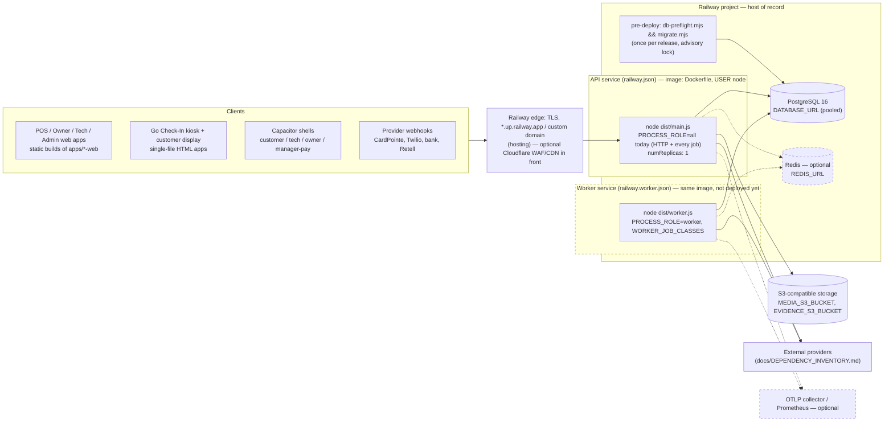
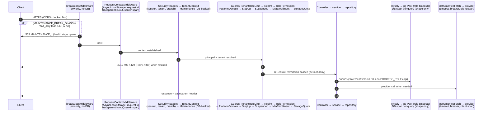
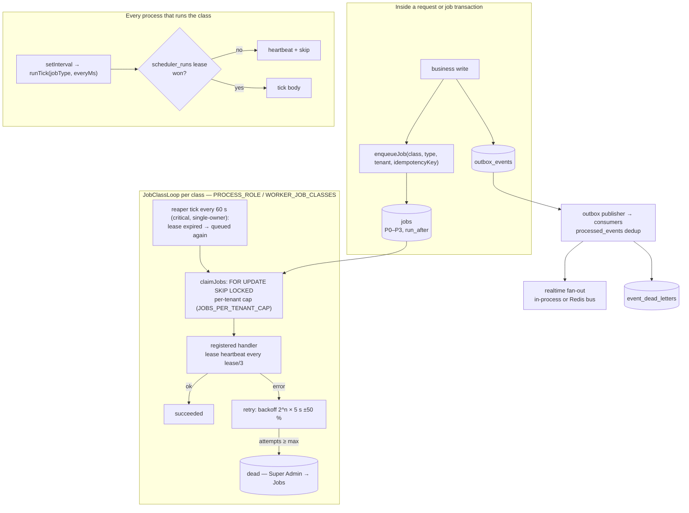
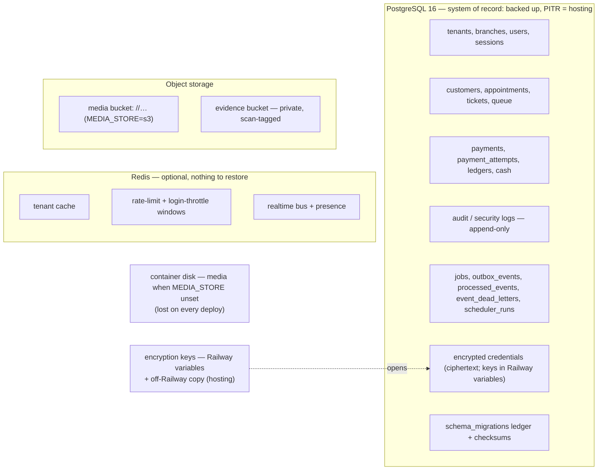
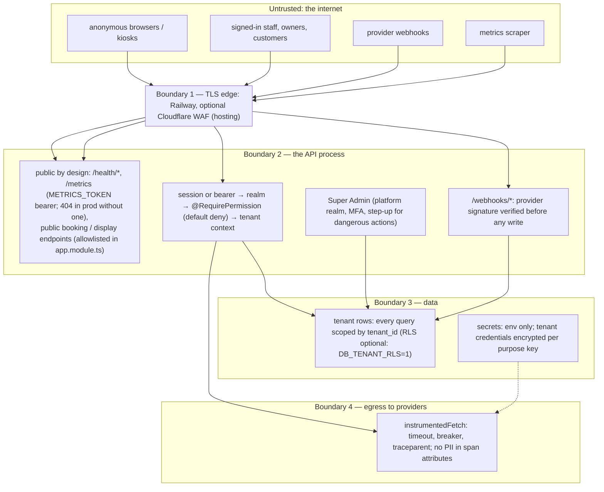

# ARCHITECTURE_DIAGRAMS.md — runtime topology, request path, job/event path, data stores, trust boundaries

Constitution 4 §191 (BUILD_PLAN Phase 11). Drawn October 8, 2026 from the tree; each diagram lists the files it was
drawn from. Railway is the host of record (`railway.json`, `railway.worker.json`); boxes marked *(hosting)* are settings
outside this repository, and dashed boxes are optional (off until their env var is set). Diagrams render on GitHub
(Mermaid).

## 1. Runtime topology

Sources: `railway.json`, `railway.worker.json`, `Dockerfile`, `apps/api/src/main.ts`, `apps/api/src/worker.ts`,
`packages/config/src/process-role.ts`, `packages/database/src/kysely.provider.ts`.

Today one API replica runs everything (`PROCESS_ROLE` unset = `all`). The split — worker service first, then the web
service to `PROCESS_ROLE=api` — is `RUNBOOKS.md` → `worker-split`. More than one API replica needs `REDIS_URL`
(`apps/api/src/common/production-config.ts` refuses `API_REPLICAS > 1` / `MULTI_INSTANCE=1` without it).

## 2. Request path (one HTTP request)

Sources: `apps/api/src/main.ts` (CORS, `breakGlassMiddleware`), `apps/api/src/app.module.ts` `configure()` and the
`APP_GUARD` list, `packages/observability/src/request-context.ts`, `packages/database/src/kysely.provider.ts`.

## 3. Job and event path

Sources: `packages/database/src/job-queue.ts`, `apps/api/src/jobs/job-worker.ts`, `packages/observability/src/scheduler-coordination.ts`,
`packages/database/src/scheduler-runs.ts` (migration 518), the outbox (`packages/events`, `apps/api/src/events`).

Exactly-once *completion* comes from the lease owner check on `completeJob`; a handler may *run* twice only when its
worker died mid-run, so handlers are idempotent (rule in `job-queue.ts`). Proven by `drill-worker-loss.mjs`.

## 4. Data stores

Retention per class: `apps/api/db/retention-policy.json`; RPO/RTO per class: `DISASTER_RECOVERY.md` §1.

## 5. Trust boundaries

Sources: `apps/api/src/app.module.ts` (public-route allowlist, guards), `apps/api/src/common/security-headers.middleware.ts`,
`apps/api/src/health/metrics.controller.ts`, the webhook controllers, `packages/database/src/tenant-session.ts`.

What crosses each boundary is logged with a request id and (when tracing is on) a trace id; tenant ids are span
attributes, personal data never is (`packages/observability/src/tracing/`).
